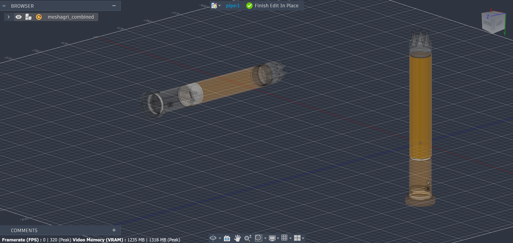
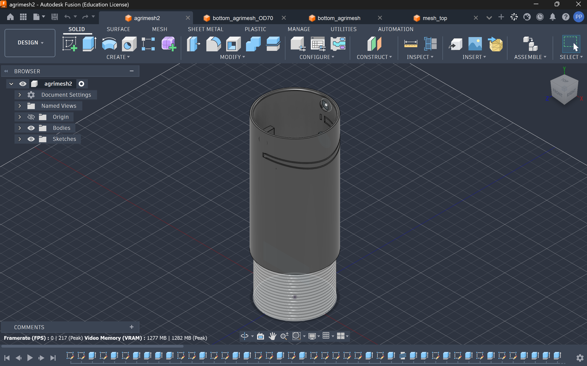
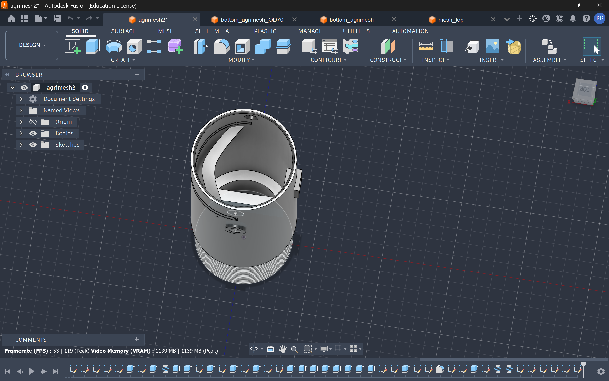
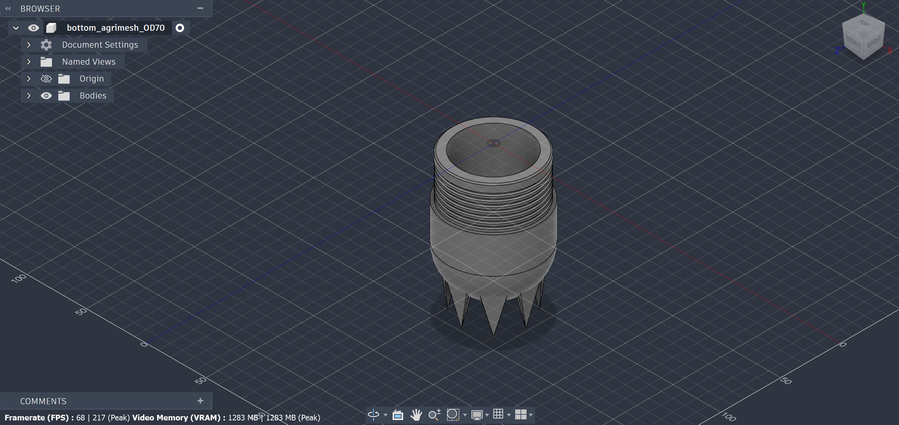
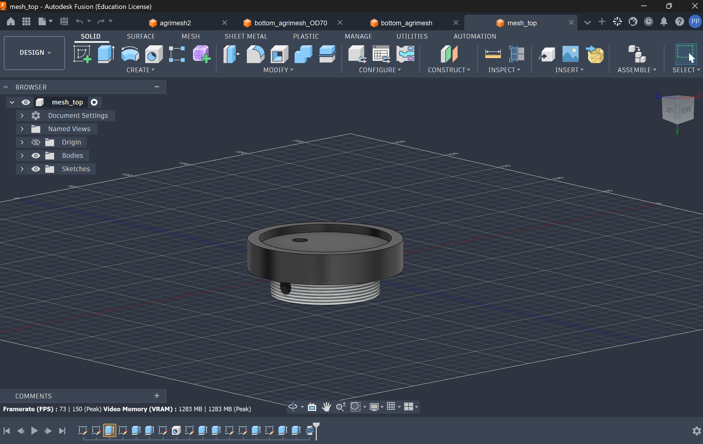
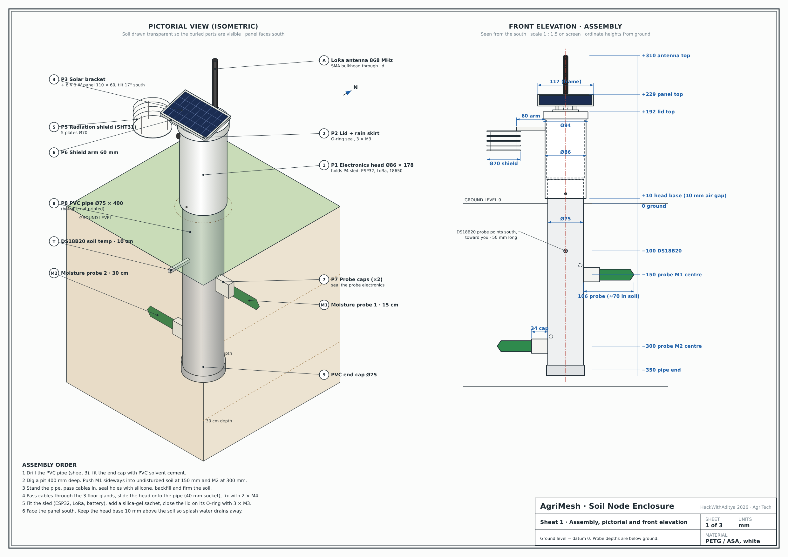

# BHOOMI Soil Node · 3D enclosure (Fusion 360 files)

> ### 🌱 Why BHOOMI
> **Affordable for every farmer, ready for every farm business.** BHOOMI uses low-cost, widely available parts,
> so a small farmer can start with one node and grow, and a vegetable company can cover many plots with the same system.
> It works **without internet**, speaks the farmer's **own language**, answers on **any basic phone by SMS**, and every part
> can be **repaired or replaced locally**. The enclosure follows the same idea: it's **3D-printed in a few parts**,
> built around a **standard Ø75 PVC pipe**, so a broken part can be reprinted and swapped instead of replacing the whole node.

This folder has the 3D design of the **Soil Node housing**: the part that stands in the field, holds the ESP32, the LoRa
radio and the battery above ground, and carries the soil probes down into the root zone.



## Folder contents

| Path | What it is |
|---|---|
| `FINAL_PRINT/` | **Final design to print** (Fusion 360, exported as STEP) |
| `FINAL_PRINT/TOP_NODE.step` | Main body: the tube that holds the electronics. Overall about 113 × 78 × 333 mm, including the side tab |
| `FINAL_PRINT/bottom_agrimesh_OD70.step` | Bottom part: threaded section with ground spikes that goes into the soil. About Ø75 × 149 mm |
| `FINAL_PRINT/TOP_CAP.step` | Top cap that screws onto the body and closes it. About Ø85 × 34 mm |
| `FINAL_PRINT/*.png` | Screenshots of each part in Fusion 360 |
| `MEDIA_FILES_(IMG&VED)/top_build.mp4` | 37-second video of the top part being modelled |
| `AgriMesh_soil_node_sheet1–3.png` | **Engineering drawings** of the first enclosure design (assembly, electronics head, lid, bracket, sled, shield, probe caps, parts list) |
| `AgriMesh_head_preview.png`, `AgriMesh_head_details.png` | Renders of the first design's head, lid and electronics sled |
| `GENERATED.zip` | First design as files: STEP + STL for the head body, lid and electronics sled, the full assembly, and the Python scripts that generate them (`head.py`, `csg.py`) |

Sizes above were measured from the STEP files' outlines. Open the files in Fusion 360 to read exact dimensions.

## The final design (FINAL_PRINT)

| Top node | Inside the top | Bottom with spikes | Top cap |
|---|---|---|---|
|  |  |  |  |

Three printed parts that screw together:
1. **Bottom (spiked, threaded):** goes into the soil first. The spikes help it enter the ground and stay upright.
2. **Top node:** the main tube that holds the ESP32, LoRa radio, 18650 battery and charger.
3. **Top cap:** screws on to close the top, with a hole for the antenna or solar panel cable.

Threaded joints make the node quick to open in the field: unscrew the cap to reach the electronics.

## First design (drawings + GENERATED.zip)



The first version was a printed electronics head on a Ø75 × 400 mm PVC pipe, with a lid and rain skirt, solar
bracket, radiation shield for the SHT31, a sliding electronics sled, and probe caps. The three drawing sheets give every
dimension, the assembly order and a parts list. `GENERATED.zip` contains its STEP/STL files and the script that builds
them, so the sizes can be changed and the parts regenerated:

```bash
unzip GENERATED.zip && python3 head.py      # writes new STEP + STL files to ./out
```

Note: the drawing sheets show the head at Ø86 mm, while `head.py` uses a Ø92 mm body. Check which one matches your build before printing.

## Print settings

From the drawing sheets; they apply to both designs:
- **Material:** PETG or ASA, white. PLA softens in summer sun and breaks down in UV, so don't use it outdoors.
- **Settings:** 0.4 mm nozzle, 0.2 mm layers, 4 walls, 5 top/bottom layers, 30 % gyroid infill.
- **Holes:** they print about 0.2 mm small; drill them to size afterwards (Ø3.4 / Ø4.5 / Ø12.5).
- **Threads:** print a short test ring of the thread first, and check it screws in smoothly before printing the full part.
- **Sealing:** a 2 mm TPU ring or O-ring cord under the cap, and silicone around every cable hole.

## Status
- **Designed, not printed yet.** The final 3-part enclosure is ready to print. The current prototype (P1) is soldered electronics, not yet in a printed housing.
- **To do:** print a test thread, check the fit with the real ESP32, LoRa module and 18650 holder, then print the full set.

## Related
- Soil Node electronics and power: [`../BHOOMI_SN`](../BHOOMI_SN)

Team BHOOMI · Chennai Institute of Technology · HackWithAditya 2026
