# About the BHOOMI Pond Node digital twin

**The BHOOMI Pond Node keeps fish and shrimp alive at night. It measures dissolved oxygen, pH and water temperature, and switches the aerator on by itself when oxygen falls. This repository is its digital twin: the pond hardware in 3D, the edge gateway, the cloud and the farmer's mobile app, in one page and running the same rules as the real firmware.**

HackWithAditya 2026 · AgriTech & Aquaculture track · Andhra Pradesh, India

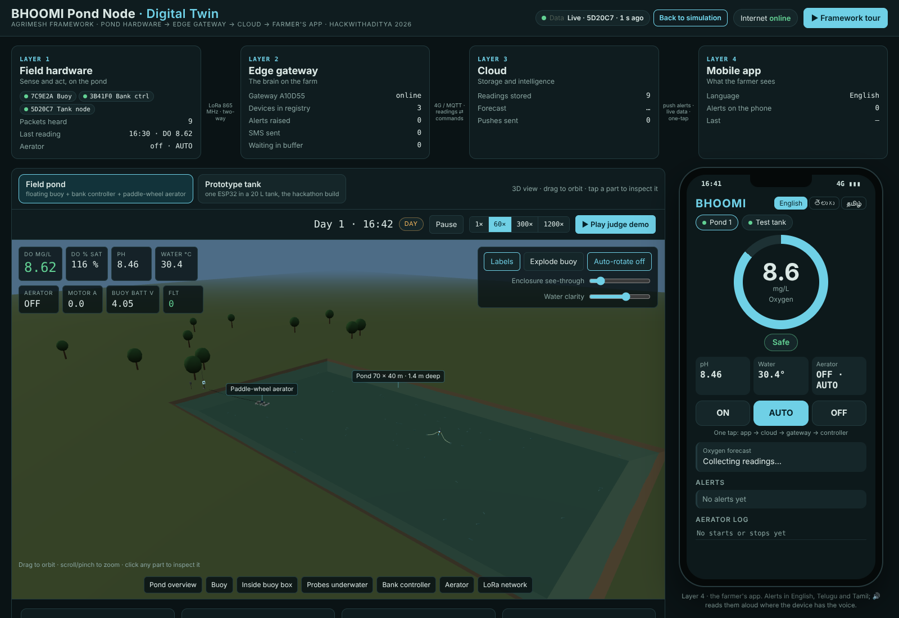

---

## Contents

1. [The problem](#the-problem)
2. [What the BHOOMI Pond Node does](#what-the-bhoomi-pond-node-does)
3. [Why a digital twin](#why-a-digital-twin)
4. [The twin: four layers in one page](#the-twin-four-layers-in-one-page)
5. [Layer 1 · field hardware in 3D](#layer-1--field-hardware-in-3d)
6. [Layer 2 · edge gateway](#layer-2--edge-gateway)
7. [Layer 3 · cloud](#layer-3--cloud)
8. [Layer 4 · the farmer's app](#layer-4--the-farmers-app)
9. [When things go wrong](#when-things-go-wrong)
10. [How it works end to end](#how-it-works-end-to-end)
11. [Technology stack](#technology-stack)
12. [3D content](#3d-content)
13. [Hardware and firmware](#hardware-and-firmware)
14. [Running it](#running-it)
15. [Repository map](#repository-map)
16. [Testing and quality](#testing-and-quality)
17. [Honest limits and next steps](#honest-limits-and-next-steps)

---

## The problem

- **Oxygen crashes at night.** In daylight, plankton makes oxygen. At night, fish, plankton and the mud all use it up. After a cloudy day with heavy plankton, dissolved oxygen (DO) can fall below 4 mg/L before dawn, the level where fish are stressed. Below about 2–3 mg/L they start dying.
- **Farmers stay awake to switch aerators by hand.** Without a measurement, they either run paddle-wheel aerators all night, which costs power, or guess and risk a crash.
- **Problems are found too late.** A tripped aerator motor, a probe cut by a boat or a flat battery are found in the morning, together with the dead fish.
- **The internet is patchy.** Any safety system that needs the cloud to switch the aerator will fail exactly when it matters.

## What the BHOOMI Pond Node does

| Part | Job |
|---|---|
| **Floating buoy** | Solar and battery powered, no mains in the water. Wakes, measures DO, pH and water temperature 60 cm deep, sends one LoRa packet, sleeps. Every 15 min by day; every 5 min at night or when DO is below 5 mg/L; every 30 min on low battery. |
| **Bank controller** | Mains-powered ESP32 beside the aerator starter. Decides the aerator: **AUTO ON below 4.0 mg/L, OFF above 6.0 mg/L**, with a minimum ON time of 20 min and OFF time of 5 min. Checks the motor current with a clamp-on sensor and has a Hand-Off-Auto switch. |
| **Failsafes** | No valid oxygen reading at night (probe fault, or buoy silent for 35 min) → run the aerator anyway. By day → hold the current state. |
| **Edge gateway** | ESP32 + LoRa + 4G at the farmhouse. Hears every device, raises alerts, sends SMS, and buffers readings when the internet is down. |
| **Cloud and app** | History, oxygen forecast, push alerts in the farmer's language, one-tap aerator control from anywhere. |
| **Prototype tank** | The hackathon build: one ESP32 in a 15–20 L tank, with the same rules and the same packets, and an air pump standing in for the aerator. |

The aerator decision is made **on the pond**. The gateway, cloud and app only watch, warn and send commands, so the fish are protected with no internet at all.

## Why a digital twin

1. **To explain.** Judges and farmers can look inside the buoy, follow every radio packet from the water to the phone, and see why the aerator started.
2. **To test before the hardware exists.** The twin runs the firmware rules on a pond model. Night crashes, motor trips, cut cables, flat batteries and internet outages can all be tried in minutes, safely.
3. **To monitor the real farm.** Press **Go live** and the same page shows data from the backend: from its simulator now, from the real gateway later.

## The twin: four layers in one page

The page follows the AgriMesh framework flowchart: **field hardware → edge gateway → cloud → mobile app**.

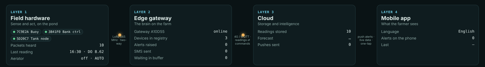

| Layer | What you see | Code |
|---|---|---|
| **1 · Field hardware** | A 3D view of the field pond or the prototype tank, running the firmware rules | `frontend/views/`, `shared/model/` |
| **2 · Edge gateway** | Registry, rules, SMS log, offline buffer | `shared/farm/gateway.cjs` |
| **3 · Cloud** | Oxygen chart with forecast, push log | `shared/farm/cloud.cjs` |
| **4 · Mobile app** | The farmer's phone | `frontend/index.html`, `shared/farm/i18n.cjs` |

The layer cards across the top are live. Amber dots fly along the links as readings move up, blue dots as commands go down, and red dots as alerts reach the phone. A red link means the internet is down.

**Simulation or Live, same code.** In Simulation, the 3D view's firmware model sends its packets to a gateway and cloud running in the browser. In Live, the backend runs the same gateway and cloud files and the browser shows what it sends over the WebSocket.

## Layer 1 · field hardware in 3D

### Field pond: the product

A 70 × 40 m earthen pond with a floating buoy, a bank-side controller, a 1 HP paddle-wheel aerator and the farmhouse gateway.

| Pond and aerator | Inside the buoy | Bank controller |
|---|---|---|
| 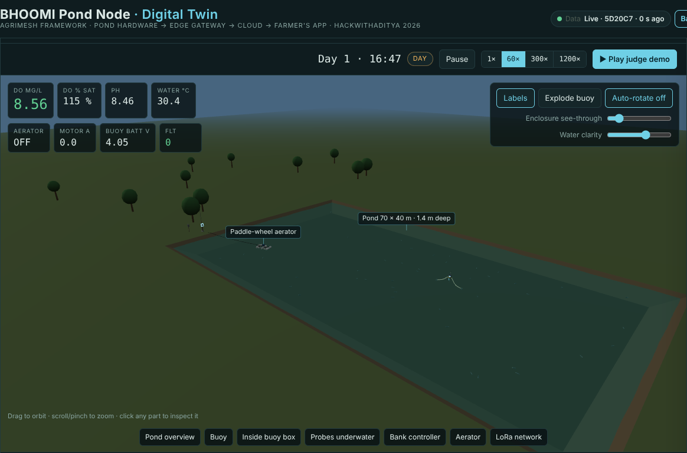 | 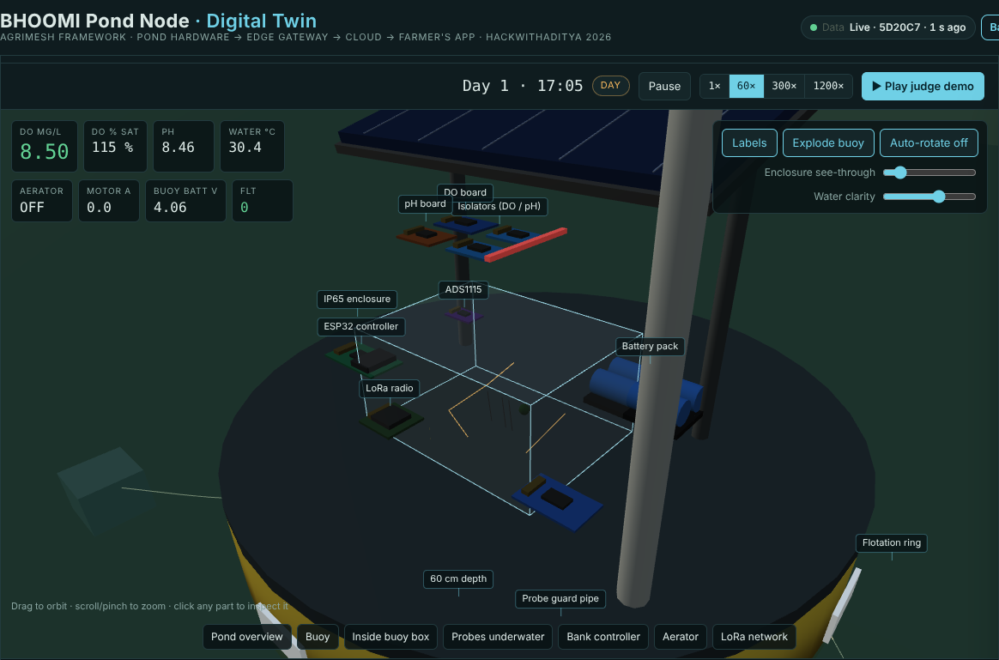 | 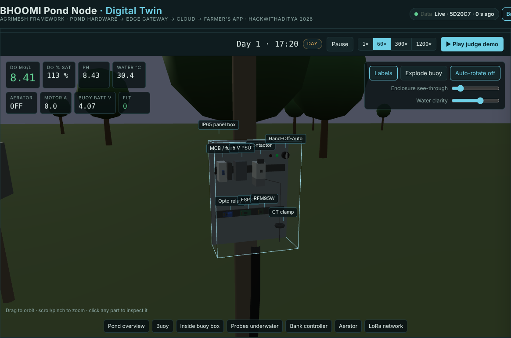 |

- **Camera presets:** pond overview, buoy, inside the buoy box, probes underwater, bank controller, aerator and LoRa network. Tap any part for its name, part number, price, pins and job.
- **Inside the buoy:** an x-ray slider and an exploded view of the electronics, plus colour-coded wiring tables for both boards.
- **Conditions:** 11 scenarios (normal day → night, night crash, aerator failure, aerator weak, gateway offline, bank controller dead, buoy lost, DO probe cut, pH probe fouled, three cloudy days, monsoon), 11 fault switches, and sliders for cloud, plankton, fish biomass, salinity, rain and battery.
- **Panels:** live readings, the decision with its reason, a 24-hour chart, the firmware state, judge numbers and the packet log.

### Prototype tank: the hackathon build

One ESP32 in a tank on a bench, with the probes, the air pump, a see-through box with colour-coded wiring and the live OLED.

| Tank prototype | Electronics, exploded |
|---|---|
| 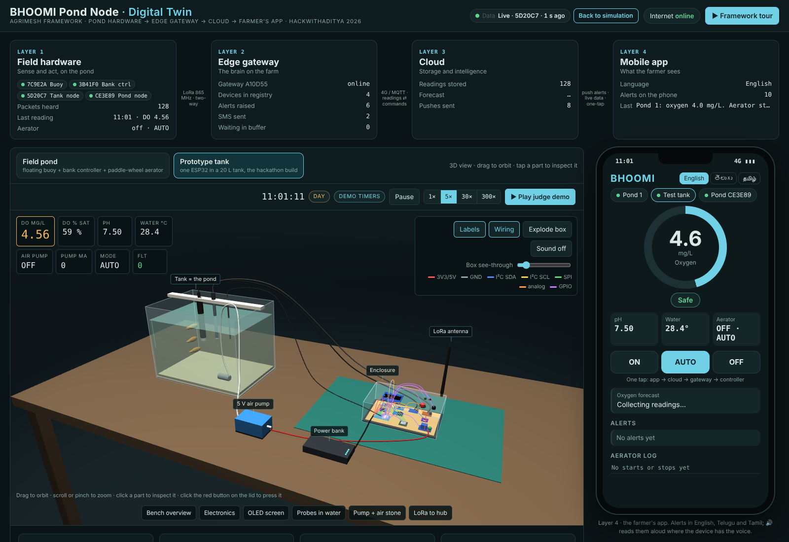 | 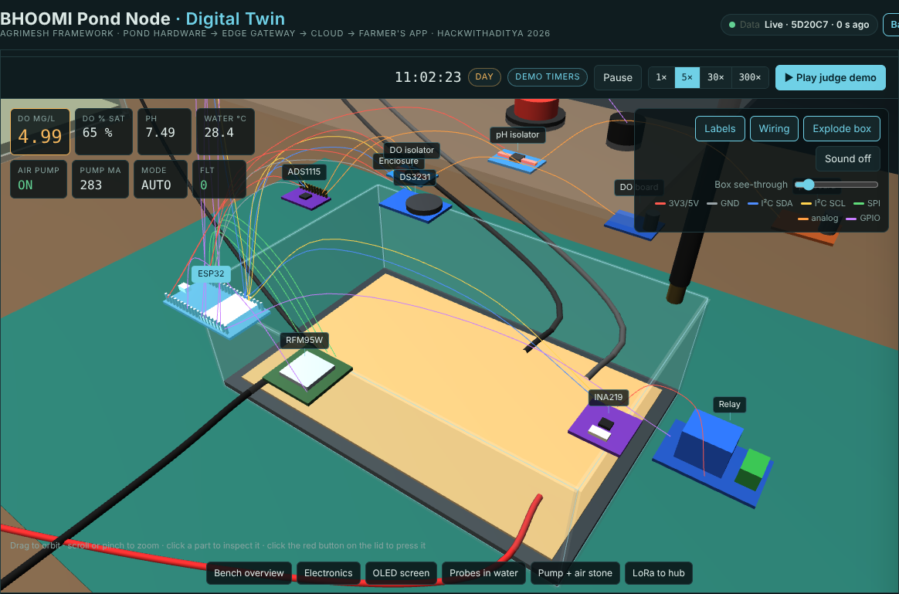 |

It has 12 scenarios and 9 fault switches, demo or real timers, the lid button, hub commands (`AER`, thresholds, `CAL`, `STATUS`) and its own 11-step judge demo.

## Layer 2 · edge gateway

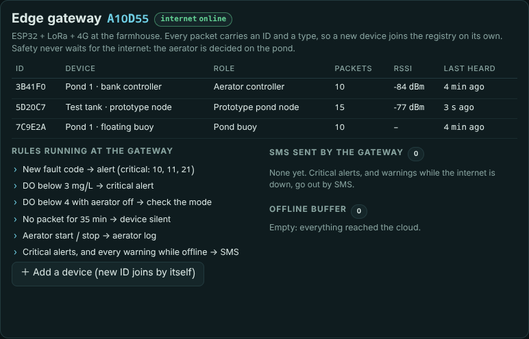

- **Registry.** Every packet carries a device ID and type, so a new device joins the registry on its own. The bank controller is registered when it relays the buoy's packets.
- **Rules on every reading:**
  - a new fault code raises an alert (critical for 10, 11 and 21);
  - DO below 3 mg/L is critical;
  - DO below 4 with the aerator off twice in a row means "check the mode";
  - a device silent for 35 min is flagged;
  - the AUTO rule's starts and stops are logged.
- **Automatic or manual?** A device switches first and confirms after. So the gateway calls a start "automatic" only when oxygen was really at the threshold, and an ACK that follows marks the start as the farmer's command.
- **SMS.** Critical alerts always go by SMS, in the farmer's language. While the internet is down, every warning does too.
- **Offline buffer.** With the internet down, readings and alerts wait in the gateway's outbox. They are flushed to the cloud, oldest first, when the link returns.

## Layer 3 · cloud

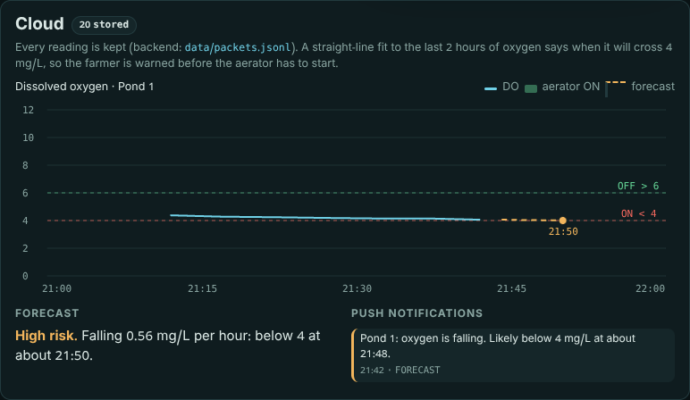

- Every reading is stored; the backend appends each packet to `data/packets.jsonl`.
- **Oxygen forecast:** a straight-line fit to the last 2 hours of DO gives the fall rate and the time it will cross 4 mg/L. When that is under 6 hours away, the cloud pushes a warning once per episode. In the night-crash run above it predicted 21:50, and the aerator started at 21:52.
- Push notifications go to the app; after an outage they are marked "delivered after the outage".

The forecast is a measured trend, not a weather model; [limits](#honest-limits-and-next-steps) says what it cannot do.

## Layer 4 · the farmer's app

| Telugu | Tamil | One tap |
|---|---|---|
| 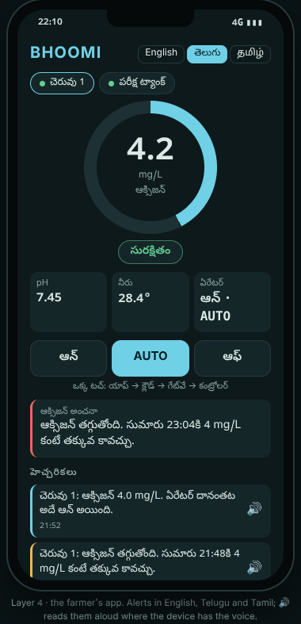 | 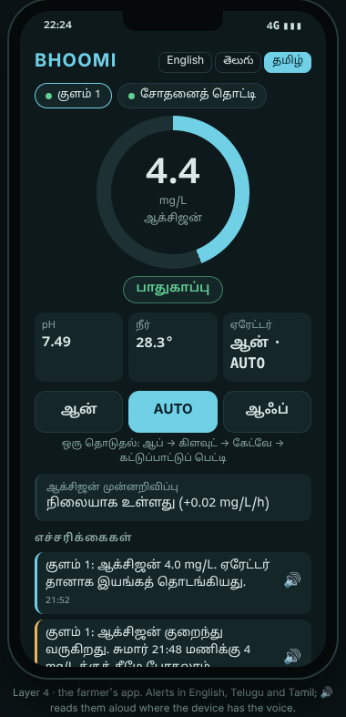 | 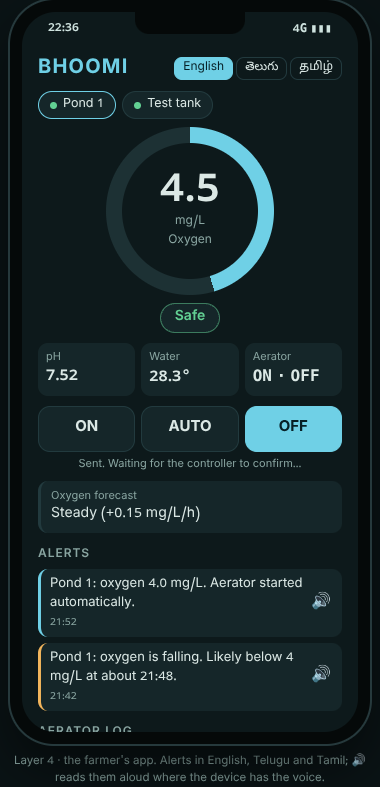 |

- **At a glance:** an oxygen gauge with the status (Safe, Watch or Danger), pH, water temperature, and the aerator state and mode.
- **One tap:** **ON / AUTO / OFF**. The command travels app → cloud → gateway → controller over LoRa, and the controller answers with an ACK.
- **Forecast card** and the **aerator log** (each start and stop with its oxygen level and mode).
- **Alerts in English, Telugu or Tamil.** 🔊 reads an alert aloud with the phone's voice for that language, where the device has one. SMS messages show in green.
- **Several ponds:** tabs for Pond 1, the test tank and any new pond node.

The Telugu and Tamil fonts ship with the app, so alerts render correctly offline.

## When things go wrong

| Situation | What happens | Shown in |
|---|---|---|
| Night oxygen crash | Cloud forecast warns first; the bank controller starts the aerator below 4.0 mg/L; the app logs "started automatically" | 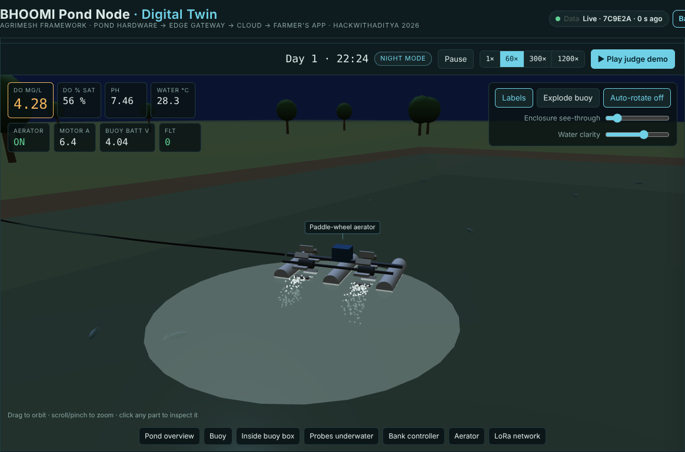 |
| Aerator motor tripped | Contactor ON but 0 A for 30 s → FLT 10, urgent packet, critical alert + SMS | [09](media/09-internet-down-sms-fallback.png) |
| Internet down | Pond loop unaffected; the gateway sends the alert by SMS and buffers readings; app commands are refused with "use the switch on the controller" | 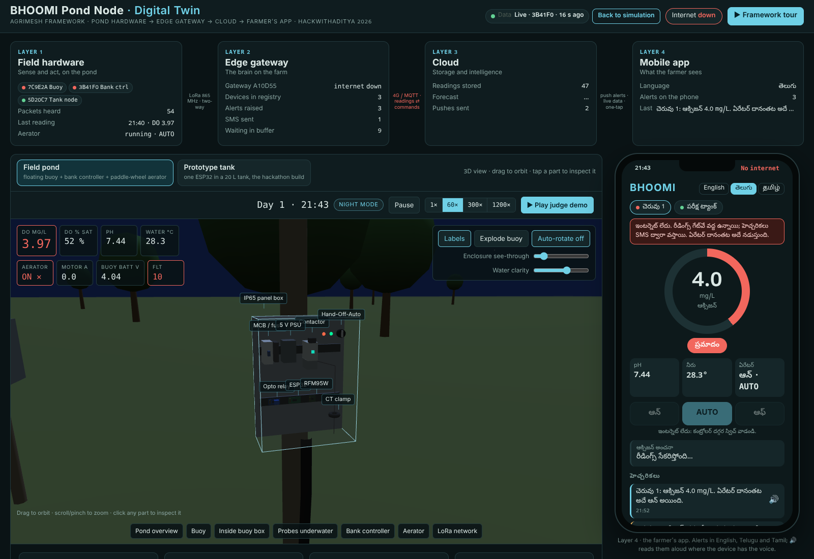 |
| Internet back | Buffer flushed; nothing lost | [10](media/10-back-online-buffer-flushed.png) |
| Aerator running but DO still falling | FLT 11 after 30 min: add a second aerator or check the paddles | scenario *Aerator running, DO still falling* |
| Buoy silent (sunk, flat) | Bank controller runs the aerator at night (FLT 20); gateway flags the device silent | scenario *Buoy lost / silent* |
| Bank controller dead | Buoy gets no ACK twice → FLT 21, sends straight to the gateway at 17 dBm | scenario *Bank controller power cut* |
| DO probe cut | FLT 1; DO ignored; aerator ON at night, held by day | scenario *DO probe disconnected* |
| pH probe fouled | pH stops moving while DO swings → FLT 5: clean the probe | scenario *pH probe fouled* |
| A new pond node powers up | Joins the registry and appears on the phone by itself | [12](media/12-new-device-joins.png) |

## How it works end to end

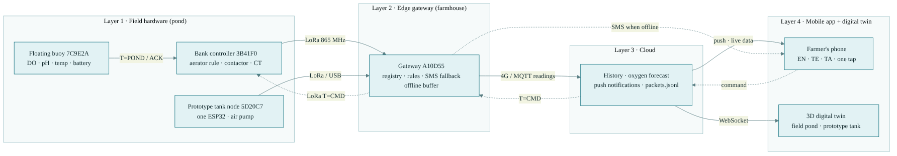

1. **Reading.** The buoy sends `AM1,ID=7C9E2A,T=POND,N=212,DO=5.84,DOS=76,PH=7.62,WT=28.6,AER=0,AERI=0.0,BV=4.04,FLT=0` to the bank controller, which ACKs, decides the aerator and relays the reading to the gateway.
2. **Gateway.** It drops duplicates, updates the registry and pond, runs the rules and sends SMS. Then it forwards the reading to the cloud, or buffers it if the internet is down.
3. **Cloud.** It stores the reading, updates the history and forecast, and pushes alerts.
4. **App and twin.** The phone shows the reading and alerts; the 3D view shows the device.
5. **Command.** `POST /api/command` → `AM1,ID=A10D55,T=CMD,N=4,DST=3B41F0,AER=ON` → the bank controller acts and answers `T=ACK,OK=1,MODE=ON,AER=1`.

**Same code in two places.** The firmware rules (`shared/model/`), packet parser, gateway, cloud and alert texts (`shared/farm/`) are plain JavaScript files. The browser loads them with `<script>`, the backend with `require()`. One copy of each rule is tested once and behaves the same in Simulation and Live.

Details: [docs/architecture.md](docs/architecture.md) · [docs/api.md](docs/api.md) · [docs/packet-format.md](docs/packet-format.md).

## Technology stack

| Layer | Technology |
|---|---|
| **3D views** | Three.js r128 (WebGL), OrbitControls, procedural geometry, raycast picking, HTML labels projected from 3D, camera presets, x-ray and explode views, CanvasTexture OLED, particle spray and bubbles |
| **App shell** | HTML5, CSS custom properties, vanilla JavaScript (ES2020), Canvas 2D chart, iframe + postMessage bridge for the 3D views; no build step |
| **Mobile app** | Phone UI with a CSS conic-gradient gauge, Noto Sans Telugu / Tamil (bundled), Web Speech API for voice |
| **Shared logic** | Plain JavaScript for browser and Node: firmware models, AM1 parser, gateway, cloud, EN / TE / TA texts |
| **Backend** | Node.js 18+, built-in modules only: `http`, own RFC 6455 WebSocket server, ES modules |
| **API** | REST / JSON + WebSocket `/ws` |
| **Gateway** | Rule engine, registry, SMS log, offline outbox |
| **Cloud** | Append-only JSONL, in-memory history, least-squares trend forecast, push notifications |
| **Inputs** | Simulator · HTTP POST · MQTT (mqtt.js + Mosquitto) · USB serial (serialport) |
| **Firmware** | Arduino C++ on ESP32: RFM95W LoRa 865 MHz, ADS1115, DFRobot DO + pH with signal isolators, DS18B20, SCT-013 current clamp, INA219, DS3231, SSD1306; deep sleep, NVS settings, watchdog; gateway with Wi-Fi, PubSubClient, HTTPClient |
| **Testing / CI** | `node:test` (23 tests), GitHub Actions on Node 18 / 20 / 22, Playwright screenshots, `arduino-cli` compile check |
| **Deployment** | Docker + docker-compose (backend + Mosquitto); laptop or Raspberry Pi |

More: [docs/tech-stack.md](docs/tech-stack.md).

## 3D content

Every 3D object is built in code from Three.js primitives, so nothing heavy is downloaded and parts can change with the hardware.

| View | Modelled in 3D |
|---|---|
| **Field pond** | **Pond and sky:** a 70 × 40 m earthen pond with a rippling surface that rain roughens; day/night sky with sun, moon, stars and fog; trees; fish that come up gasping when oxygen is low.<br>**Buoy:** foam ring, deck, IP65 box with ESP32, RFM95W, ADS1115, two isolators, DO and pH boards, battery and charger; 5 W solar panel, antenna mast, slotted probe guard with DO, pH and temperature probes at 60 cm, ballast and mooring.<br>**Bank controller:** DIN box with 5 V supply, opto relay, contactor, MCB, current clamp and Hand-Off-Auto switch.<br>**Aerator and network:** 1 HP paddle-wheel aerator with spinning impellers, spray and foam; farmhouse gateway; LoRa packets flying between buoy, bank and gateway. |
| **Prototype tank** | **Bench:** a glass tank with probes 15 cm deep, air stone and bubbles, fish, 5 V air pump, power bank, LoRa antenna and the farmhouse hub.<br>**Electronics:** a see-through box with every module and colour-coded wiring between the real pins, an exploded view, and a live OLED that draws exactly what the firmware draws. |

## Hardware and firmware

| Device | Main parts | Firmware |
|---|---|---|
| Floating buoy | FireBeetle 2 ESP32-E · RFM95W · ADS1115 · DFRobot SEN0237-A DO + SEN0169-V2 pH, each through a DFR0504 isolator · DS18B20 · 2 × 18650 + CN3791 + 5 W panel · foam ring, IP65 box | `firmware/pond-buoy/PondBuoy` |
| Bank controller | ESP32-DevKitC · RFM95W · DS3231 · HDR-15-5 supply · opto relay → contactor coil · SCT-013-030 clamp · Hand-Off-Auto | `firmware/pond-bank-controller/PondBank` |
| Prototype tank | ESP32 · RFM95W · ADS1115 · same probes and isolators · DS18B20 · INA219 · relay + 5 V air pump · DS3231 · OLED · power bank | `firmware/prototype-tank/BhoomiPondNode` (v2.1) |
| Edge gateway | ESP32 · RFM95W · Wi-Fi to a 4G router | `firmware/gateway/BhoomiPondGateway` |

All devices share one radio setting: 865.0625 MHz, SF9, BW 125 kHz, CR 4/5, sync word 0x12. The probes dominate the cost, at about ₹31,000–37,000 for the prototype's electronics.

Parts, pins and wiring: [field pond](firmware/field-pond-WIRING.md) · [prototype tank](firmware/prototype-tank/WIRING.md). **All mains wiring must be done and signed off by a licensed electrician.**

## Running it

Needs Node.js 18 or newer; no `npm install` for the core.

```bash
cd backend
npm start
# open http://localhost:8080 → "Go live" → "▶ Framework tour"
```

| Want to… | Do this |
|---|---|
| Use it with no backend | open `frontend/index.html` from disk (Simulation) |
| Open the tank view first | `http://localhost:8080/frontend/?view=tank` |
| Start the phone in Telugu | `?lang=te` (or `ta`) |
| Make the pond faster | `SIM_FIELD_SPEED=300 npm start` |
| Send test packets | `SIM=0 npm start`, then `node tools/send-packet.js --pumpfail` |
| Use the prototype over USB | `npm install serialport`, `SIM=0 SERIAL_PORT=COM5 npm start` |
| Use the gateway over Wi-Fi | flash `BhoomiPondGateway` (MQTT mode), `docker compose up`, `SIM=0` |
| Cut the internet from a script | `POST /api/link {"online":false}` |

## Repository map

```
frontend/          the app: shell (index.html, js/app.js, css/), 3D views (views/field-pond, views/prototype-tank), vendor/, fonts/
shared/            model/ (firmware rules), protocol/ (AM1), farm/ (gateway, cloud, texts), live/ (Simulation/Live switch)
backend/           Node.js gateway + cloud + API + simulator; test/; tools/send-packet.js
firmware/          PondBuoy, PondBank, BhoomiPondNode v2.1, BhoomiPondGateway, wiring guides
docs/              architecture, API, packet format, technology stack
media/             screenshots with explanations
```

## Testing and quality

- **Backend tests** (`cd backend && npm test`, 23 tests):
  - AM1 parser;
  - field model: auto start, FLT 10, FLT 21, FLT 20 failsafe, pH fouling caught with no false alarm over 8 crash nights;
  - tank model: AUTO, faults, failsafes, commands;
  - gateway: registry, duplicates, three languages, SMS, offline buffer, silence;
  - cloud: forecast;
  - end to end: ingest → gateway → cloud → WebSocket, internet cut and restore, commands with ACK, both simulated devices.
- **CI:** GitHub Actions on Node 18, 20 and 22, plus a syntax check of every frontend and shared script.
- **Browser:** the app was run in headless Chromium in Simulation (from disk and served), in Live, and with the simulator off fed by test packets. There were no script errors. The `media/` screenshots come from those runs.
- **Firmware:** all four sketches compile for ESP32 Dev Module (Arduino-ESP32 3.0.7) with no warnings in the sketch code.
- **A model bug fixed on the way:** the field model's pH lagged oxygen by an hour, which raised false "pH probe fouled" alarms on about 2% of crash nights. With pH following oxygen within 10 minutes, as it does in a real pond, there were none in 600 simulated nights, and a fouled probe is still caught within 45 minutes. The buoy firmware rule did not need to change.

## Honest limits and next steps

- **Hardware testing is pending.** The firmware compiles and its rules are modelled and tested in the twin; the tank test and pond trial still need to happen. Treat numbers as prototype numbers.
- **The models are illustrative.** The pond physics (sun, plankton, respiration, aeration, pH) is tuned to show effects in minutes, not to predict a particular pond.
- **The forecast is a trend line.** It extrapolates the last 2 hours of oxygen; it does not know about tomorrow's weather. A weather API and a learned night-respiration model are the next step.
- **Sensor accuracy.** Galvanic DO is about ±0.2–0.3 mg/L after weekly air calibration, with membrane service every 1–2 months. pH is about ±0.1 with 2-point calibration and weekly cleaning.
- **SMS and push are simulated.** The gateway logs the SMS text it would send; a GSM modem or SMS API, and a real push service, are still to be connected.
- **The Telugu and Tamil texts** should be checked by a native speaker before field use. Voice depends on the phone having those voices.
- **Device IDs.** Real boards use their MAC-based ID. Add them to `KNOWN` in `shared/farm/gateway.cjs` to give them the field names; unknown IDs still work as new ponds.
- **One radio band.** The pond devices use 865 MHz; the BHOOMI soil nodes use 433 MHz. Either one band for both, or a gateway with two radios, is needed for one farm network.
- **Security for field use:** MQTT passwords and TLS, `INGEST_TOKEN`, and login on commands.

---

MIT licence. Three.js © Three.js authors (MIT). Noto Sans Telugu / Tamil © The Noto Project Authors (SIL OFL 1.1).
