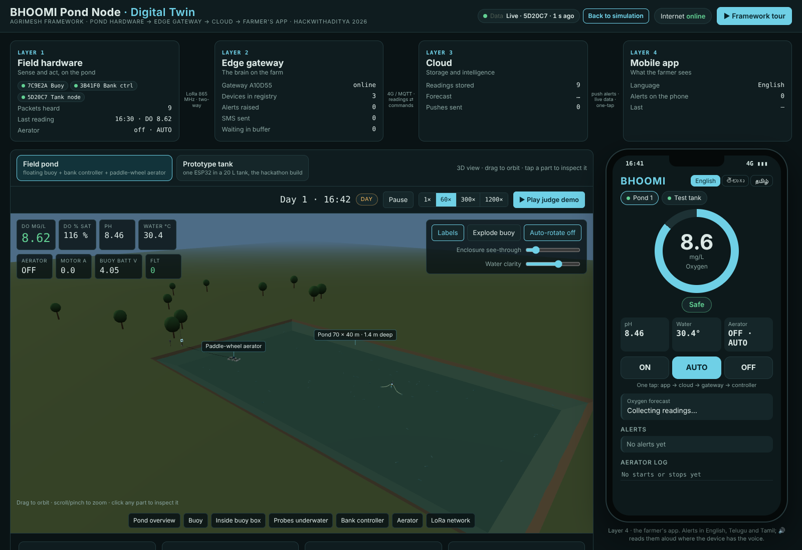

# BHOOMI Pond Node · Digital Twin

**One digital twin for the whole pond system: the pond hardware in 3D, the edge gateway, the cloud and the farmer's mobile app, working live in one page.**

HackWithAditya 2026 · AgriTech & Aquaculture track · Andhra Pradesh, India



The BHOOMI Pond Node watches a fish or shrimp pond. It measures **dissolved oxygen, pH and water temperature**, switches the **aerator on by itself** when oxygen falls at night, and tells the farmer when a probe, the aerator or the power fails. It keeps working with no internet.

This twin follows the four layers of the AgriMesh framework:

| Layer | In the twin |
|---|---|
| **1 · Field hardware** | Two 3D views running the real firmware rules: the **field pond** (floating solar buoy + bank-side controller + paddle-wheel aerator) and the **prototype tank** (the hackathon build, one ESP32 in a 20 L tank) |
| **2 · Edge gateway** | Device registry, alert rules, aerator log, SMS fallback, offline buffer |
| **3 · Cloud** | History of every reading, oxygen trend forecast, push notifications |
| **4 · Mobile app** | Phone screen: oxygen gauge, status, alerts in **English, Telugu and Tamil** (with voice), one-tap aerator control |

It runs two ways with the same code. **Simulation** needs nothing installed, not even a backend, and the gateway and cloud run in the browser. **Live** uses the Node.js backend, which runs the gateway and cloud and takes packets from its simulator or from real hardware.

**Full write-up: [ABOUT.md](ABOUT.md)** · screenshots explained: [media/README.md](media/README.md)

## Quick start

Needs Node.js 18 or newer. No `npm install` for the core.

```bash
cd backend
npm start
# open http://localhost:8080 , press "Go live", then "Framework tour"
```

Without the backend, open `frontend/index.html` straight from disk: everything runs in Simulation.

| Try this | Where |
|---|---|
| Watch a night oxygen crash and the aerator start by itself | 3D view → Scenarios → *Night oxygen crash* |
| Get warned before it happens | Cloud panel → forecast; phone → alert |
| Read the alert in Telugu or Tamil, hear it | Phone → తెలుగు / தமிழ் → 🔊 |
| Switch the aerator from the phone | Phone → ON / AUTO / OFF (the controller answers with an ACK) |
| Cut the internet | Header → *Internet online* → SMS fallback, readings buffered, flushed when restored |
| Add a new device | Gateway panel → *＋ Add a device* |
| Guided demo for judges | Header → *▶ Framework tour* (10 steps) · each 3D view also has its own *Play judge demo* |

## Real hardware

```bash
cd backend && npm install serialport          # or: npm install mqtt  +  docker compose up
SIM=0 SERIAL_PORT=COM5 npm start              # Linux / macOS: /dev/ttyUSB0
```

Plug in the gateway (`firmware/gateway`), or the prototype tank node on its own: firmware v2.1 takes commands over USB, so it works two-way with no gateway. Without hardware, `node backend/tools/send-packet.js --pumpfail` sends test packets.

Firmware, parts and wiring: [firmware/README.md](firmware/README.md).

## Repository

```
frontend/                     the app (open index.html)
  index.html  css/  js/app.js   shell: four layers, phone, gateway and cloud panels, framework tour
  views/field-pond/             3D view: pond, buoy, bank controller, aerator
  views/prototype-tank/         3D view: tank prototype bench
  vendor/  fonts/               Three.js r128 + OrbitControls; Noto Sans Telugu / Tamil (OFL)
shared/                       same code in the browser and the backend
  model/field-model.cjs         buoy + bank controller firmware rules, pond physics
  model/tank-model.cjs          prototype tank firmware rules
  protocol/am1.cjs              AM1 packet parser
  farm/gateway.cjs  cloud.cjs   layer 2 and layer 3
  farm/i18n.cjs                 alert texts: English, Telugu, Tamil
  live/                         Simulation / Live switch + WebSocket client
backend/                      Node.js: gateway + cloud, REST, WebSocket, simulator (no dependencies)
firmware/                     PondBuoy, PondBank, BhoomiPondNode v2.1, BhoomiPondGateway + wiring guides
docs/                         architecture, API, packet format, technology stack
media/                        screenshots with explanations
```

## Docs

- [About BHOOMI Pond Node (full write-up)](ABOUT.md)
- [Architecture](docs/architecture.md) · [Backend API](docs/api.md) · [AM1 packet format](docs/packet-format.md) · [Technology stack](docs/tech-stack.md)
- [Firmware, parts and wiring](firmware/README.md)
- [Screenshots explained](media/README.md)

## Licence

MIT. Three.js © Three.js authors (MIT). Noto Sans Telugu / Tamil © The Noto Project Authors (SIL OFL 1.1, `frontend/fonts/OFL.txt`).
