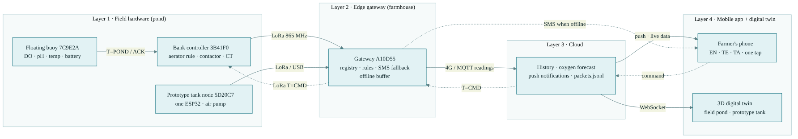

# Architecture

The digital twin follows the four layers of the AgriMesh framework flowchart: **field hardware → edge gateway → cloud → mobile app**. All four run in one page.



Source: [`architecture.mmd`](architecture.mmd) (Mermaid).

## Same code, two places

| Code | Browser (Simulation) | Backend (Live) |
|---|---|---|
| [`shared/model/field-model.cjs`](../shared/model/field-model.cjs): buoy + bank controller firmware rules and pond physics | the field-pond 3D view runs it | the simulator runs it and sends its packets |
| [`shared/model/tank-model.cjs`](../shared/model/tank-model.cjs): prototype tank firmware rules | the prototype-tank 3D view runs it | the simulator runs it |
| [`shared/protocol/am1.cjs`](../shared/protocol/am1.cjs): AM1 parser | app shell | ingest |
| [`shared/farm/gateway.cjs`](../shared/farm/gateway.cjs): registry, rules, alerts, SMS fallback, offline buffer | app shell | gateway layer |
| [`shared/farm/cloud.cjs`](../shared/farm/cloud.cjs): history, forecast, pushes | app shell | cloud layer |
| [`shared/farm/i18n.cjs`](../shared/farm/i18n.cjs): alert texts in English, Telugu, Tamil | phone | SMS and pushes |

Every file is written as a plain script with `module.exports` when loaded by Node, so one copy of each rule is tested once (`backend/test/`) and behaves the same in Simulation and Live.

## Frontend

```
frontend/index.html          app shell: four layer cards, 3D view, phone, gateway and cloud panels, framework tour
frontend/js/app.js           wires the layers; Simulation pipeline (in-browser gateway + cloud) and Live pipeline (WebSocket)
frontend/views/field-pond/   3D view: 70 × 40 m pond, floating buoy, bank controller, paddle-wheel aerator
frontend/views/prototype-tank/  3D view: bench with the tank, probes, see-through electronics box
frontend/js/view-bridge.js   postMessage link between a 3D view (iframe) and the shell
```

Each 3D view is its own page in an iframe, so its Three.js scene, controls and CSS never interfere with the other. Opened on its own (no `?embed=1`), a view is a complete standalone twin.

| View → shell | Shell → view |
|---|---|
| `pkt`: a packet the gateway would hear (Simulation) | `setLive`: switch Simulation / Live |
| `clock`: the device's farm clock, every second | `cmd`: one-tap command from the phone |
| `reset`: scenario or time jump | `scenario`, `cam`: used by the framework tour |
| `height`: page height, so there is one scroll bar | |

## Data path

1. A device sends `T=POND` after each sample (field: buoy → bank → gateway; tank: node → gateway).
2. The **gateway** drops duplicates, updates the registry and pond state, runs the rules, raises alerts and logs aerator starts and stops. Critical alerts, and every warning while the internet is down, go out by SMS.
3. With the internet up, the reading and its alerts go to the **cloud**; with it down, they wait in the gateway's outbox and are flushed when the link returns.
4. The **cloud** stores the reading (`data/packets.jsonl` in the backend), updates the pond history, checks the oxygen trend and pushes notifications.
5. The **app** shows the reading, the alerts in the farmer's language, the forecast and the aerator log; the **3D view** shows the device itself.

## Command path

Phone → `POST /api/command` → gateway → `AM1,ID=A10D55,T=CMD,DST=3B41F0,AER=ON` over LoRa (MQTT `bhoomi/hub/down` or USB serial to the gateway firmware) → the bank controller acts and answers `T=ACK`, which comes back as a normal packet. With the internet down the cloud cannot reach the farm, so the app refuses the command and points to the Hand-Off-Auto switch.

## Clocks

Each simulated device keeps its own clock, so a scenario can jump the pond to 21:00 without moving the tank. Gateway and cloud times are farm-clock seconds; real devices use India time. When a simulator jumps in time, the gateway restarts that device's silence timer and the cloud clears that pond's history.

## Safety stays on the pond

The aerator rule, minimum ON/OFF times and failsafes run on the bank controller (or the tank node) itself. The gateway, cloud and app watch, warn and send commands; none of them is needed to keep the fish alive.
