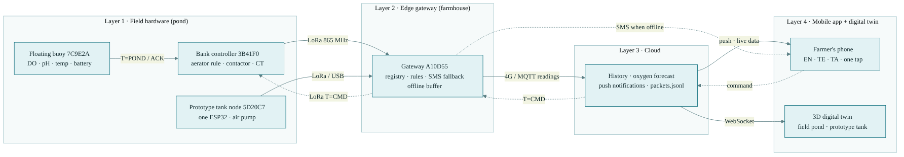

# Media: the digital twin, screen by screen

Every image was captured from the running twin in headless Chromium (1600 × 1100). Unless marked otherwise, shots are in **Live** mode: the backend runs the field pond and the prototype tank on the shared firmware models, and the gateway and cloud on the shared farm modules. Shot 16 comes from a backend with the simulator off, fed with test packets as if from real hardware.

`architecture.png` shows the four layers of the AgriMesh framework and how readings, alerts and commands move between them. Source: [`docs/architecture.mmd`](../docs/architecture.mmd).

## The whole twin

| File | What it shows |
|---|---|
| `00-app-overview.png` | The page: the four layer cards across the top, the 3D field pond (afternoon, healthy, DO 8.6 mg/L), and the farmer's phone showing *Safe*. The header holds the Simulation / Live switch, the internet switch and the framework tour. |
| `01-framework-four-layers.png` | The four layers, live. **Field hardware:** each device with its status dot. **Edge gateway:** online, devices, alerts, SMS, buffer. **Cloud:** readings stored, forecast, pushes. **Mobile app:** language and last alert. Dots fly along the links as packets move. |

## Layer 1 · field hardware in 3D

| File | What it shows |
|---|---|
| `02-field-pond-3d.png` | The field pond view: the 70 × 40 m pond, the paddle-wheel aerator, the floating buoy and the HUD with DO, saturation, pH, water temperature, aerator, motor current, buoy battery and fault code. |
| `03-buoy-electronics-explode.png` | *Inside buoy box* camera with **Explode buoy**: ESP32, LoRa radio, ADS1115, the two signal isolators, DO and pH boards and the battery pack pulled apart above the foam ring, with the solar panel overhead. |
| `04-bank-controller.png` | *Bank controller* camera: the see-through DIN box with MCB/fuse, 5 V supply, contactor, opto relay, ESP32 + RFM95W, the current clamp and the Hand-Off-Auto switch. |
| `05-night-crash-aerator-starts.png` | *Night oxygen crash*, 22:24: DO fell below 4 mg/L and the bank controller switched the aerator ON by itself (6.4 A motor current). The impellers spin and throw spray. |
| `13-prototype-tank-view.png` | The **Prototype tank** tab: the hackathon build on its bench in the *Low DO* scenario. The phone now has three ponds: Pond 1, the test tank and a new pond node. |
| `14-prototype-tank-electronics.png` | Prototype tank, electronics camera, exploded: ESP32, RFM95W, ADS1115, isolators, DS3231, INA219, relay and buzzer with colour-coded wiring between the real pins. |

## Layer 2 · edge gateway

| File | What it shows |
|---|---|
| `07-gateway-registry-rules.png` | The gateway panel: the device registry (buoy 7C9E2A, bank controller 3B41F0, tank node 5D20C7) with packets, RSSI and last heard. The relayed packets' RSSI belongs to the bank, the device the gateway actually hears. Also the rules it runs, the SMS it has sent and the offline buffer. |
| `09b-gateway-offline-buffer.png` | Internet down: the badge turns red, the aerator-failure alert went out by **SMS**, and readings and alerts wait in the buffer. |
| `12-new-device-joins.png` | **Add a device**: a pond node with an unknown ID sends its first packet and joins the registry by itself (marked NEW), with no code change. |

## Layer 3 · cloud

| File | What it shows |
|---|---|
| `08-cloud-forecast-chart.png` | The cloud panel during the night crash: the oxygen line falling 0.56 mg/L per hour, the dashed forecast reaching the ON < 4 line at 21:50, *High risk*, and the push notification sent at 21:42. The aerator started at 21:52. |
| `10-back-online-buffer-flushed.png` | Internet restored: the buffer is flushed, the readings appear in the history, and the alerts raised during the outage reach the app marked *delivered after the outage*. |

## Layer 4 · the farmer's app

| File | What it shows |
|---|---|
| `06-phone-telugu-alerts.png` | The phone in **Telugu**: oxygen gauge, status, pH, water, aerator, one-tap buttons, the forecast and the alerts, including "aerator started by itself" and the earlier forecast warning. 🔊 reads an alert aloud. |
| `06b-phone-tamil-alerts.png` | The same screen in **Tamil**. |
| `11-one-tap-command-ack.png` | Just after tapping **OFF**: the command went app → cloud → gateway → bank controller, and the controller confirmed mode OFF. The tile reads *ON · OFF* because the aerator itself keeps running until its 20-minute minimum ON time is over; the firmware protects the motor even from the farmer's own tap. |

## When things go wrong

| File | What it shows |
|---|---|
| `09-internet-down-sms-fallback.png` | Internet cut, then the aerator motor trips. In 3D the contactor is ON but the motor draws 0 A, so the HUD shows FLT 10. The link from gateway to cloud is red, and 9 items are buffered. The phone (in Telugu) shows *No internet*, the alert arrives as an SMS, and the ON/OFF buttons are disabled with "use the switch on the controller". |
| `15-framework-tour.png` | The **Framework tour**, step 2 of 10: the *Layer 1* card is highlighted, the pond is set to the night crash, and a caption explains the step. |
| `16-real-hardware-packets.png` | Simulator off (`SIM=0`), packets sent with `backend/tools/send-packet.js` as if from a real gateway: a healthy reading, low DO with the aerator running, an aerator failure (FLT 10), the tank node, and a brand-new device. The field view follows the packets, the clock follows India time, and the phone shows the alert by push and by SMS. |

## Re-taking screenshots

1. `cd backend && npm start` (and a second copy with `SIM=0 PORT=8081` for shot 16).
2. Open `http://localhost:8080/`, press **Go live**, and pick a scenario in the 3D view.
3. Capture at 1600 × 1100 and keep the file names, so this page, the README and ABOUT keep working.
