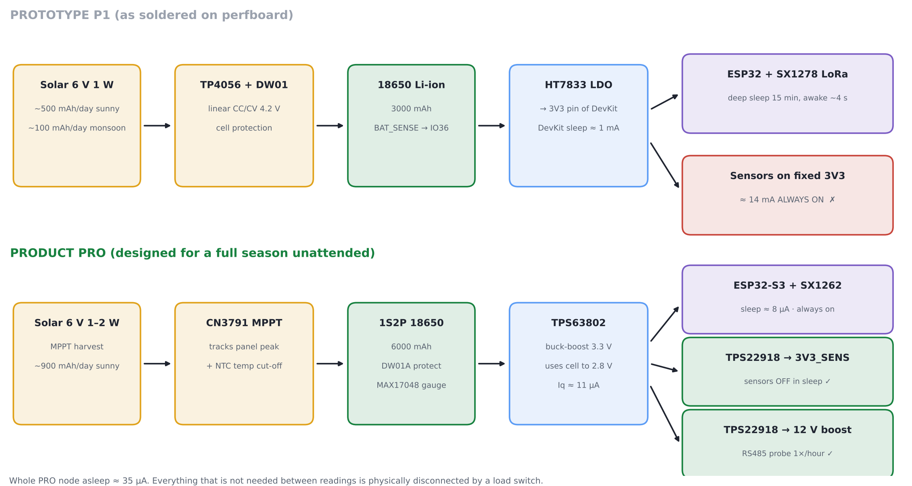
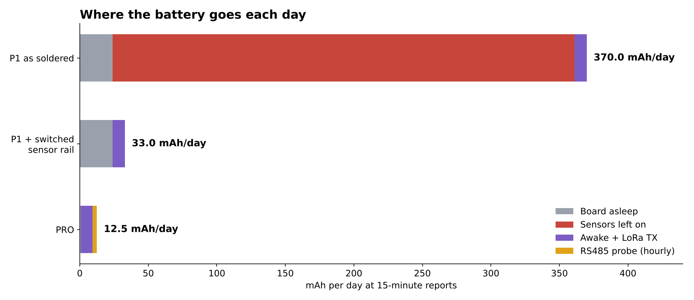
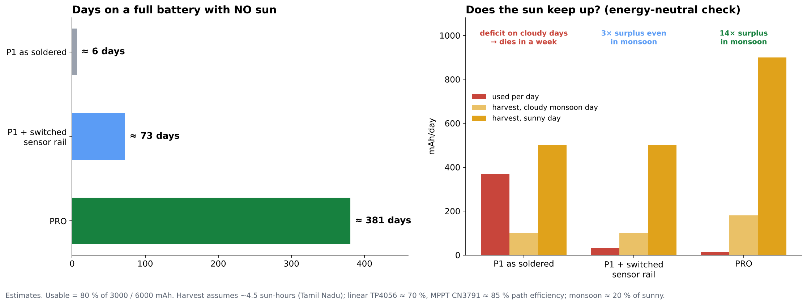
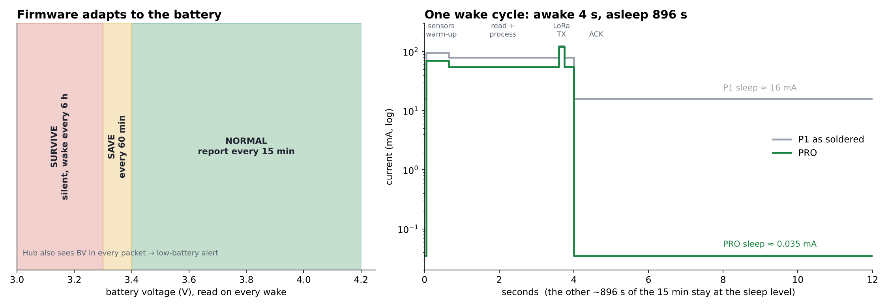

# BHOOMI Soil Node — Power & Battery Life

> ### 🌱 Why BHOOMI
> **Affordable for every farmer, ready for every farm business.** BHOOMI uses low-cost, widely available parts,
> so a small farmer can start with one node and grow, and a vegetable company can cover many plots with the same system.
> It works **without internet**, speaks the farmer's **own language**, answers on **any basic phone by SMS**, and every part
> can be **repaired or replaced locally**. This page shows one reason it stays cheap to run: **a soil node runs for months on one battery.**

How the soil node runs for months on one battery, for the prototype (P1) and the product (PRO).

| | P1 as soldered | P1 + switched sensor rail | PRO |
|---|---|---|---|
| Battery | 1 × 18650, 3000 mAh | 1 × 18650, 3000 mAh | 1S2P 18650, 6000 mAh |
| Charger → regulator | TP4056 → HT7833 | TP4056 → HT7833 | CN3791 MPPT → TPS63802 |
| Sleep current | ≈ 15 mA | ≈ 1 mA | ≈ 35 µA |
| Energy per day | 370 mAh | 33 mAh | 12.6 mAh |
| Life with no sun | ≈ 6 days | ≈ 73 days | ≈ 381 days |

**Why it lasts:**
- **Deep sleep:** the node is awake for about 4 s every 15 min.
- **Sensors off between readings:** the sensors are switched fully off.
- **Solar top-up:** the battery is recharged every day.
- **Adaptive reporting:** the firmware reports less often as the battery drops: every 15 min, then every 60 min, then silent for 6 h.

## Power chain

## Daily energy budget

## Battery life and solar

## Adaptive duty cycle

**Full write-up:** [BHOOMI_SoilNode_Power_Life.pdf](BHOOMI_SoilNode_Power_Life.pdf)

All figures are design estimates. Measure the real sleep current with BHOOMI_HardwareTest (test 7).
