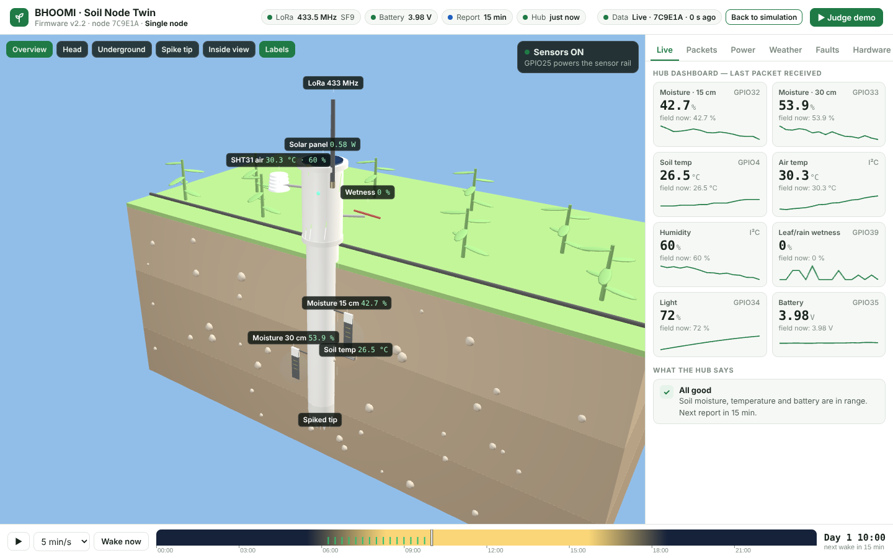

# BHOOMI Digital Twin

**Interactive 3D digital twins of the BHOOMI LoRa smart-farm network, with a live Node.js backend.**

HackWithAditya 2026 · AgriTech & Aquaculture track · Andhra Pradesh, India



BHOOMI puts small solar LoRa nodes in the field. Each twin here is a 3D copy of that hardware: it runs its own simulation, and when served by the backend it switches to **live data**, so judges and farmers see exactly what the real nodes report.

## Stages

| Stage | Folder | Status |
|---|---|---|
| 1 · Single soil node | [`stage-1-single-soil-node`](stage-1-single-soil-node/) | ✅ Twin + backend + live data |
| 2 · Multi soil node field | `stage-2-multi-soil-node` | Next |
| 3 · Mesh hub and farm | `stage-3-mesh-hub` | Planned |

## Quick start

Needs **Node.js 18 or newer**. No `npm install` for the core.

```bash
git clone https://github.com/<your-user>/bhoomi-digital-twin.git
cd bhoomi-digital-twin/backend
npm start
```

Open **http://localhost:8080**, pick a stage and press **Go live**. The built-in simulator sends one soil report every 15 s, standing in for the node's 15-minute reports.

Send your own packet:

```bash
node tools/send-packet.js --dry
```

Settings are environment variables (see [docs/api.md](docs/api.md)). On Windows PowerShell use `$env:SIM="0"; npm start`; on macOS/Linux `SIM=0 npm start`.

With Docker (backend + Mosquitto MQTT broker):

```bash
docker compose up --build
```

## Repository

```
backend/                     Node.js server: REST, WebSocket, simulator, MQTT/serial inputs, tests
shared/                      Three.js (vendored) and the live client used by every twin
stage-1-single-soil-node/    Stage 1 twin (frontend/)
docs/                        Architecture, API, packet format, technology stack
media/                       Screenshots of each stage with captions
```

## Technology

Three.js (WebGL) · vanilla JavaScript · HTML/CSS · Node.js · WebSocket · REST · MQTT · JSONL · ESP32 · LoRa. Details: [docs/tech-stack.md](docs/tech-stack.md).

## Docs

- [Architecture](docs/architecture.md)
- [Backend API](docs/api.md)
- [AM1 packet format](docs/packet-format.md)
- [Technology stack](docs/tech-stack.md)

## Licence

MIT. Three.js is © Three.js authors, MIT.
