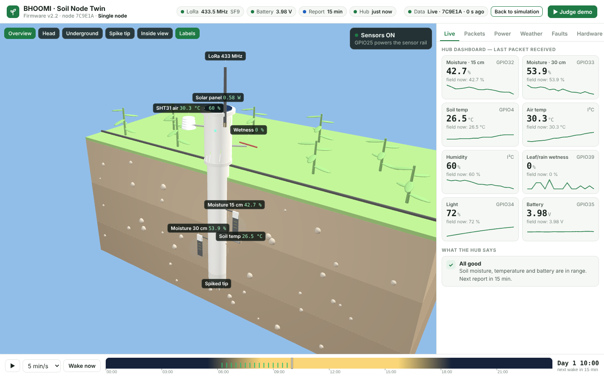

# Stage 1 · Single soil node

A 3D digital twin of one BHOOMI soil node, from the solar lid down to the spiked tip, connected to the backend so it can show **real packets** as well as its own simulation.



## What the twin shows

| Area | Details |
|---|---|
| **3D node** | Solar-panel lid, 433 MHz antenna, SHT31 sun shield, LDR window, tilted wetness strip, status LED, Ø75 PVC body, spiked tip |
| **Soil cutaway** | Moisture probes at 15 cm and 30 cm and the DS18B20; soil colour follows moisture |
| **Inside view** | See-through head with the ESP32, LoRa module, 18650 cell and TP4056 charger; tap any part for its pin and job |
| **Wake cycle** | Wake → sensors on (GPIO25) → read → build packet → LoRa TX → ACK from the hub → deep sleep |
| **Hub dashboard** | Eight reading cards with sparklines and the hub's advice (irrigate, waterlogged, heat stress, fungal risk, low battery, sensor fault, node silent) |
| **Packets** | Last AM1 packet decoded field by field, plus the radio log |
| **Power** | Battery, solar charging, sleep current options and days without sun |
| **Weather / Faults** | Normal, heatwave, monsoon, drought, cloudy week, night dew; unplug sensors, hub offline, loose antenna, dusty panel |
| **Judge demo** | 10-step guided walkthrough with captions |

## Simulation and Live

The header has a **Data** switch:

- **Simulation**: the twin runs its own soil physics and firmware v2.2 model. Works from disk with no backend.
- **Live**: the twin pauses its model and every packet from the backend (simulator, hub over MQTT/HTTP, or USB serial) updates the cards, alerts, packet log, battery and the 3D soil colour.

## Run it

```bash
cd backend
npm start                 # no npm install needed
# open http://localhost:8080/stage-1-single-soil-node/frontend/  and press "Go live"
```

Useful URL options: `?live=1` (start in Live), `?node=7C9E1A` (pick a node), `?backend=http://192.168.1.20:8080` (use another server).

Try the hub alerts with test packets:

```bash
node backend/tools/send-packet.js --dry     # topsoil dry -> "irrigate"
node backend/tools/send-packet.js --wet     # waterlogged
node backend/tools/send-packet.js --fault   # M1 and DS18B20 missing -> sensor fault
```

## Files

```
frontend/
  index.html            page markup
  css/twin.css          styles, light and dark theme
  js/twin.js            Three.js scene, firmware v2.2 model, hub rules, UI
  js/live-adapter.js    maps backend SOIL packets onto the twin
```

Screenshots with captions: [`media/stage-1`](../media/stage-1/README.md).
