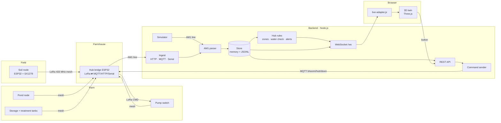

# Architecture



## Backend (`backend/`)

| File | Job |
|---|---|
| `src/server.js` | HTTP server: static frontends, REST API, WebSocket upgrade, starts the packet sources |
| `src/am1.js` | Parse and build AM1 packets; field names and units |
| `src/store.js` | Latest state per node, history ring (500 per node), duplicate filter, JSONL log |
| `src/ws.js` | Small RFC 6455 WebSocket server (text frames, ping/pong) |
| `src/sources/simulator.js` | Soil-physics simulator that emits real AM1 packets |
| `src/sources/mqtt.js` | Optional MQTT subscriber (`bhoomi/+/up`) |
| `src/sources/serial.js` | Optional USB-serial reader for a hub plugged into the laptop |
| `src/sources/farm.js` | Stage 3 farm model: pond, pump, treatment and storage tanks, zone valves, crop water check |
| `src/hub/rules.js` | Hub rules: zones, water verdict, alerts (`GET /api/hub`) |
| `tools/send-packet.js` | Send a test packet (`--dry`, `--wet`, `--fault`) |

Every packet, whatever its source, goes through one function, `ingest(line, rx)`:

1. `parseAM1` checks the format and turns `NA` into `null`.
2. `Store.add` drops duplicates (the same `ID:N` heard via two mesh routes), updates the node and appends to `packets.jsonl`.
3. The store emits `packet`, and the WebSocket hub pushes `{type:"packet", record}` to every open twin.

## Frontend (`stage-*/frontend/`)

Each stage is a static page with the same layout:

```
frontend/
  index.html          markup only
  css/twin.css        styles (light + dark)
  js/twin.js          3D scene, firmware model, hub rules, UI (runs on its own)
  js/live-adapter.js  maps backend packets onto this twin's state
```

`shared/live/bhoomi-live.js` adds the **Data: Simulation / Live** switch to every twin header and manages the WebSocket (auto-reconnect, `?live=1` to start live, `?backend=http://host:8080` to point at another server).

In **Simulation** the twin runs its own physics and firmware model. In **Live** it pauses that model and every packet from the backend updates the readings, the 3D soil colour, the hub alerts and the packet log.

## Stages

| Stage | Twin | Backend adds |
|---|---|---|
| 1 | Single soil node | Core server, REST, WebSocket, JSONL store, single-node simulator |
| 2 | Multi soil node field | Multi-node simulator with hops and per-node soils |
| 3 | Mesh hub and farm | Farm devices on the mesh, hub rules, `/api/hub`, `/api/command` with ACKs, hub bridge firmware |

## Commands (stage 3)

1. The farmer presses **Start pump** in the twin (Live).
2. `POST /api/command {"dst":"P1A2B3","set":{"RUN":1}}`.
3. The backend builds `AM1,ID=HUB000,T=CMD,N=4,DST=P1A2B3,RUN=1` and publishes it on `bhoomi/hub/down` (and USB serial).
4. The hub bridge transmits it into the mesh; the pump switch acts and answers `AM1,ID=P1A2B3,T=ACK,N=4,OK=1,RUN=1`, then reports its new state.
5. Both packets come back up like any other and the twin shows the pump running.

Safety does not depend on this path: the pump switch keeps its own dry-run, phase and run-time protection, and the pond node runs its aerator rule by itself.
