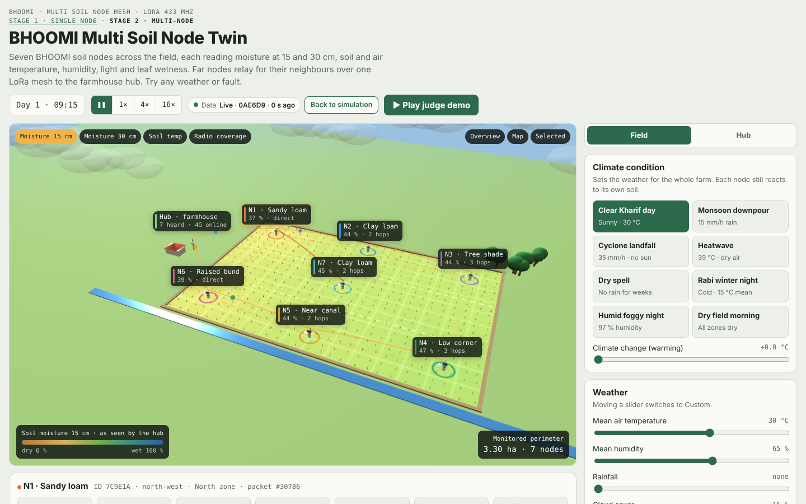

# Stage 2 · Multi soil node field

A 3D digital twin of a **280 × 200 m field with seven BHOOMI soil nodes** on six soil types, one LoRa **mesh** to the farmhouse hub, and a soil map the hub builds from every node's readings. Connected to the backend, it shows the real packets and the real routes they took.



## What the twin shows

| Area | Details |
|---|---|
| **Field** | Seven nodes: sandy loam (N1), clay loam (N2, N7), tree shade (N3), low corner (N4), near canal (N5), raised bund (N6). Up to 9 with **+ Add a node** |
| **Mesh** | Each node transmits at 5 dBm (≈158 m range). Near nodes reach the hub directly; far nodes relay through neighbours, e.g. `N3 → N2 → N1 → Hub` |
| **Self-healing** | Fail a node and the nodes behind it find a new route by themselves; turn mesh relaying off and only nodes in direct range get through |
| **Soil map** | The hub interpolates every node into one ground map: moisture 15 cm, moisture 30 cm, soil temperature or radio coverage |
| **Weather** | Kharif day, monsoon, cyclone, heatwave, dry spell, Rabi winter night, foggy night, dry morning; each soil reacts its own way |
| **Per-node controls** | Soil type, working / failed, battery, and each sensor Auto / Manual / Unplugged (`NA`) |
| **Hub** | Alerts from the packets that actually arrived, 24-hour charts, packet log with route and weakest-link RSSI |
| **Judge demo** | 8 steps: normal operation, a node failing, no mesh, dry spell, cyclone, adding a node, humid night, heatwave |

## Live mode

Press **Go live** in the header. The twin pauses its own model and:

- each SOIL packet updates its node, battery and the soil map;
- the packet animates along the route the backend reports (`rx.path`);
- a node that stops reporting is shown as failed, and the mesh re-routes around it;
- the **weather buttons**, **Node working** and **Mesh relaying** now control the backend simulator, so the whole stack reacts.

## Run it

```bash
cd backend
npm start                     # simulator runs the 7-node field (SIM_STAGE=2, the default)
# open http://localhost:8080/stage-2-multi-soil-node/frontend/ and press "Go live"
```

Drive the backend simulator from a terminal (the twin follows within one report):

```bash
curl -X POST localhost:8080/api/sim/nodes/3F21A0 -d '{"on":false}'        # N2 fails -> N3 re-routes via N7
curl -X POST localhost:8080/api/sim/weather -d '{"preset":"monsoon"}'     # normal|monsoon|cyclone|heatwave|drought|fog
curl -X POST localhost:8080/api/sim/mesh -d '{"on":false}'               # direct links only
curl localhost:8080/api/sim                                               # fleet, weather and every route
```

On Windows PowerShell, write the body as `-d '{\"on\":false}'` with `curl.exe`, or use `Invoke-RestMethod -Method Post -Uri http://localhost:8080/api/sim/mesh -Body '{"on":false}'`.

## Files

```
frontend/
  index.html            page markup
  css/twin.css          styles, light and dark theme
  js/twin.js            Three.js field, nodes, mesh routing, soil map, hub rules, UI
  js/live-adapter.js    maps backend packets, routes and simulator state onto the field
```

Screenshots with captions: [`media/stage-2`](../media/stage-2/README.md).
