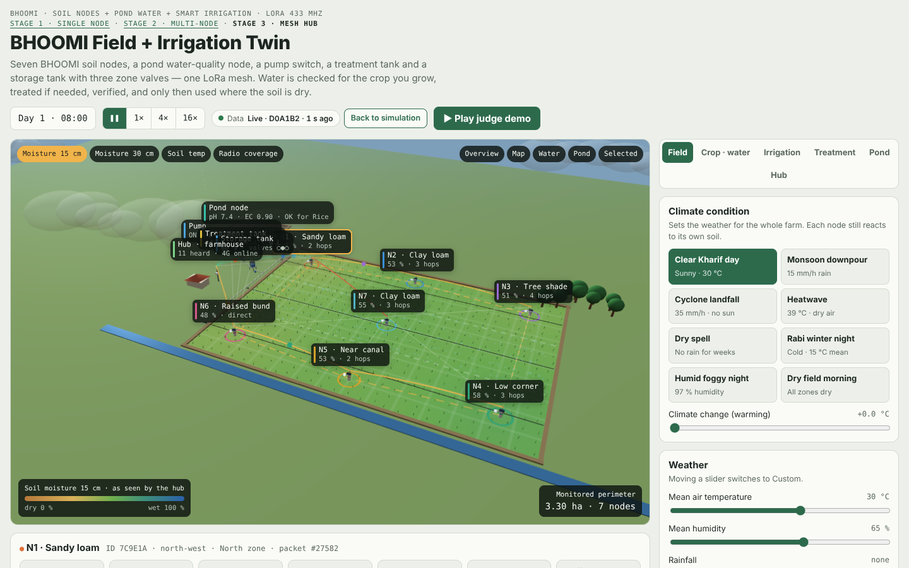

# Stage 3 · Mesh hub and farm

The whole farm on **one LoRa mesh** with the **hub** at the centre: seven soil nodes, the pond water node, the pump switch, the treatment tank and the storage tank with three zone valves. The hub turns their packets into decisions (crop water check, irrigation, alerts) and sends commands back. The twin shows all of it in 3D, live from the backend, and its buttons send **real commands**.



## What is on the mesh

| Device | ID | Packet | Sends |
|---|---|---|---|
| Soil nodes N1–N7 | `7C9E1A` … `0AE6D9` | `T=SOIL` | moisture 15/30 cm, soil and air temperature, humidity, light, wetness, battery, hops |
| Pond water node | `D0A1B2` | `T=POND` | `PH`, `EC` (dS/m), `TU` turbidity (NTU), `WT` °C, `DO` mg/L, `LV` level %, `AER` aerator 0/1 |
| Pump switch | `P1A2B3` | `T=PUMP` | `RUN` 0/1, `I` motor amps, `PHASE` OK/FAIL, `RT` run minutes, `Q` L/min, `TRIP` |
| Treatment tank | `M5A6B7` | `T=TREAT` | `LV` %, `PH`, `EC`, `STAGE` IDLE/FILLING/DOSING/READY, `DOSE` |
| Storage tank | `T4C5D6` | `T=TANK` | `LV` %, `Q` L/min out, `P` bar, `VLV` valve bits (North/Middle/South), `LIT` litres delivered |

The pump, tanks and pond node are mains or solar powered and relay for others, so the pond node reaches the hub as `Pond node → Pump → Hub`.

## What the hub decides

- **Crop water check:** pond pH 6.5–8.4, EC against the crop's FAO 29 salt-tolerance limit, turbidity ≤ 50 NTU for drippers. Rice, wheat, tomato, onion, orange, grape.
- **Irrigation:** a zone's valve opens when its mean 15 cm moisture drops below the crop trigger (rice 50 %), for at most 90 min per session; it stays shut when it rains.
- **Tank refill:** the pump starts below 40 % and stops at 95 %. Bad pond water goes through the treatment tank first (dosed towards pH 7.2).
- **Pump protection:** dry run (low current) trips and locks for 60 min; a missing phase refuses to start; 120 min maximum run. This runs in the pump switch itself, so it works with the hub offline.
- **Alerts:** node not reporting, dry zone, waterlogged, heat stress, sensor fault, low battery, pump trip, low tank, pond water not suitable, pond oxygen low.

## Live mode and commands

Press **Go live**. Then, in the twin:

| Control | What happens |
|---|---|
| **Start / Stop pump** | `POST /api/command {"dst":"P1A2B3","set":{"RUN":1}}` → `AM1,ID=HUB000,T=CMD,N=4,DST=P1A2B3,RUN=1` → the pump answers `T=ACK,OK=1` and reports its new state |
| **Zone valve buttons** | `{"dst":"T4C5D6","set":{"VLV":"011"}}` |
| **Aerator on / off / auto** | `{"dst":"D0A1B2","set":{"AER":"ON"}}` |
| **Crop buttons, automatic refill, pond events, pump faults, weather, node working, mesh** | `/api/sim/...` (built-in simulator) |

With real hardware, the same command line goes out over MQTT (`bhoomi/hub/down`) or USB serial to the hub bridge, which transmits it into the mesh.

## Hub bridge firmware

[`firmware/BhoomiHubBridge`](firmware/BhoomiHubBridge/BhoomiHubBridge.ino): ESP32 + SX1278 at the farmhouse.

- Receives every AM1 packet, ACKs soil nodes the way `soil_node_v2.2` expects (`ACK,<ID>,<N>,HUB`), drops duplicates.
- Sends packets to the backend by **MQTT** (`bhoomi/<hubId>/up`), **HTTP** (`/api/ingest`) or **USB serial** (`RX AM1,... RSSI -96 SNR 7.5`).
- Buffers up to 64 packets while Wi-Fi is down.
- Transmits commands from `bhoomi/hub/down` (or typed in the Serial Monitor) into the mesh.

Settings at the top of the file: Wi-Fi, `UPLINK_MODE`, broker/backend address. Radio: 433.5 MHz, SF9, BW 125 kHz, CR 4/5, sync word 0x12, matching the soil nodes. It compiles cleanly for "ESP32 Dev Module" (core 3.0.7) in all three uplink modes; libraries: LoRa (Sandeep Mistry), PubSubClient.

## Run it

```bash
cd backend
npm start                    # SIM_STAGE=3 (default): soil nodes + pond + pump + tanks
# open http://localhost:8080/stage-3-mesh-hub/frontend/ and press "Go live"
```

```bash
curl localhost:8080/api/hub                                                         # zones, water check, alerts
curl -X POST localhost:8080/api/command -d '{"dst":"P1A2B3","set":{"RUN":1}}'       # start the pump
curl -X POST localhost:8080/api/sim/pond -d '{"event":"acid"}'                      # acid runoff into the pond
curl -X POST localhost:8080/api/sim/crop -d '{"crop":"onion"}'                      # change the crop
```

Real hardware: flash the hub bridge, start Mosquitto (`docker compose up`), then `SIM=0 MQTT_URL=mqtt://localhost:1883 npm start` (after `npm install mqtt`).

## Files

```
frontend/
  index.html            page markup
  css/twin.css          styles, light and dark theme
  js/twin.js            Three.js farm: field, mesh, pond, pump, tanks, hub rules, crop water check, UI
  js/live-adapter.js    maps every packet type onto the farm; turns twin controls into commands
firmware/
  BhoomiHubBridge/      ESP32 hub: LoRa <-> MQTT / HTTP / USB serial
```

Screenshots with captions: [`media/stage-3`](../media/stage-3/README.md).
