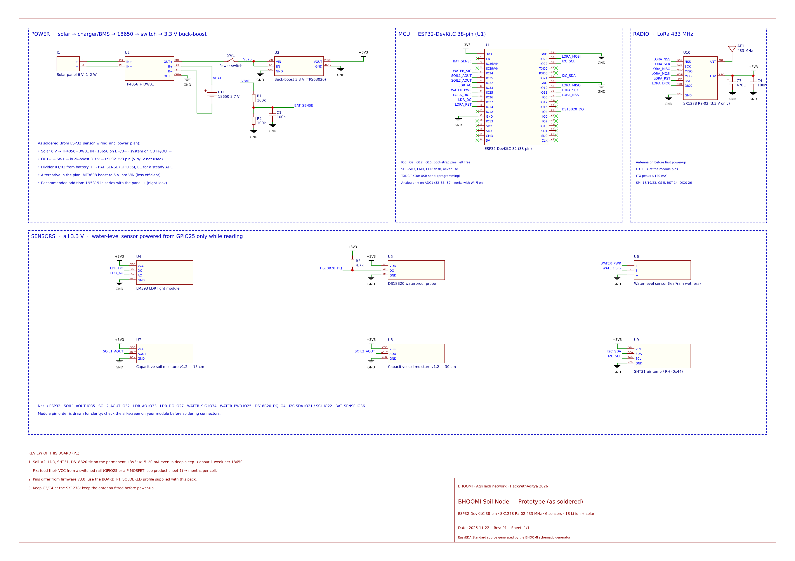
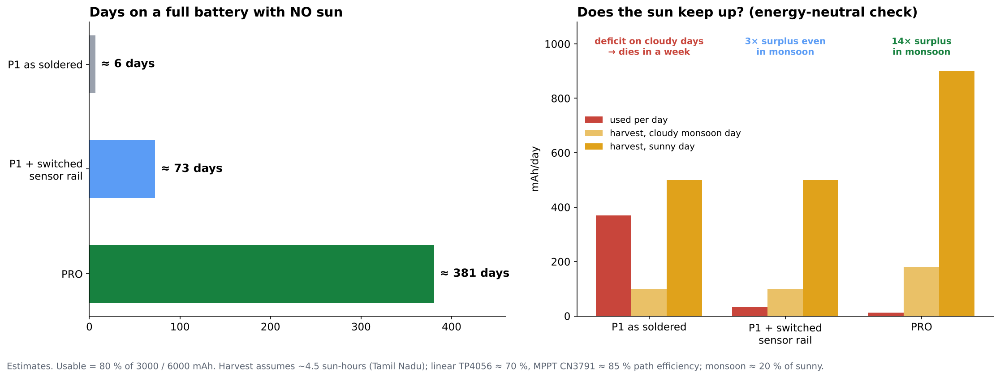
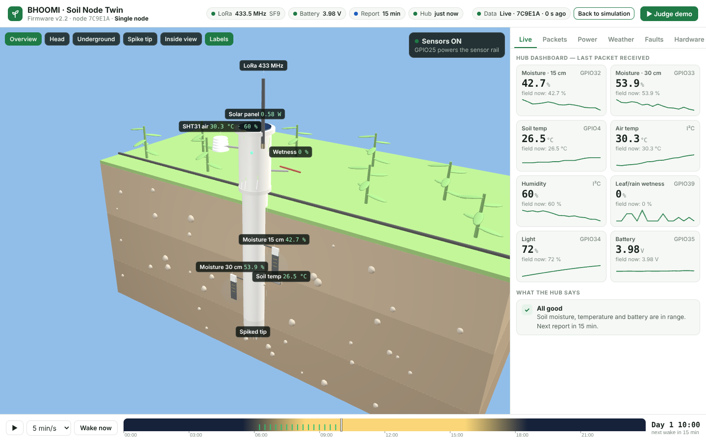
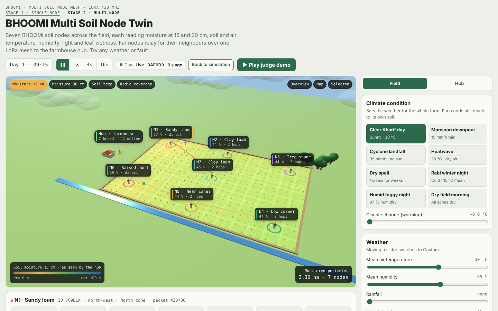
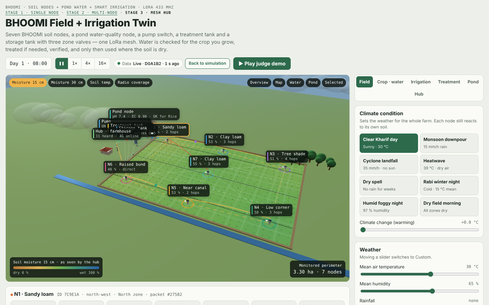
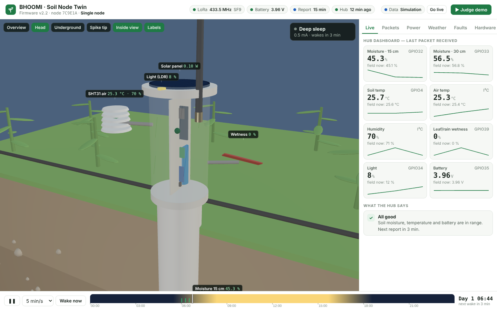
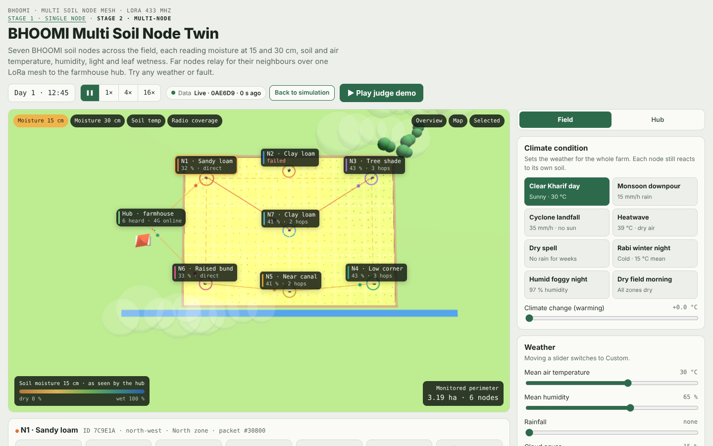
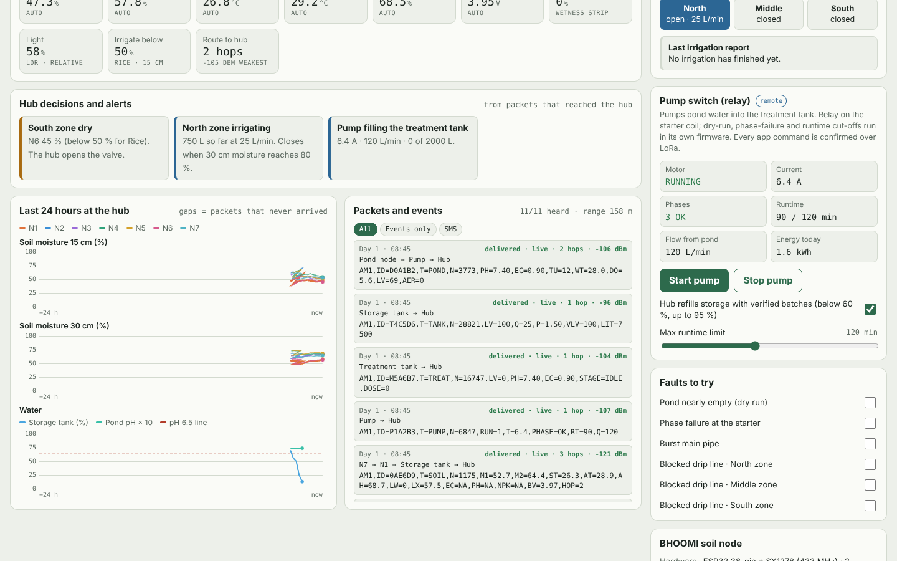

# BHOOMI Soil Node (BHOOMI_SN)

**A low-cost, solar-powered LoRa sensor that stands in the field and tells the farmer what is happening at the roots.**
Every 15 minutes it measures soil moisture at two depths, soil and air temperature, humidity, light and leaf wetness, works out simple
warnings on the node itself, sends one radio packet to the farm hub, and goes back to sleep. Nodes relay for each other, so one hub covers the whole farm.

> ### 🌱 Why BHOOMI
> **Affordable for every farmer, ready for every farm business.** The Soil Node is built from common, low-cost parts
> (ESP32, LoRa, capacitive soil sensors, one 18650 cell and a small solar panel), so a small farmer can start with one node
> and a vegetable company can cover every plot. It works **without internet**, runs for **months on one battery**,
> needs **no corroding metal probes**, and every part can be **bought and replaced locally**.
> Readings reach the farmer in their **own language**, by app, voice or **SMS on any basic phone**, through UZHAVAN AI.



---

## What's in this folder

| Folder | What you'll find | Highlights |
|---|---|---|
| [`ELECTRONICS/`](ELECTRONICS/) | Firmware, schematics and the wiring/power plan | **Firmware v3.1** (`BHOOMI_SoilNode.ino`), P1 schematic, **EasyEDA schematics** for the P1 prototype and the PRO product, 4-page wiring and power plan |
| [`BHOOMI_SoilNode_Power/`](BHOOMI_SoilNode_Power/) | Power and battery-life study | P1 vs PRO power chain, daily energy budget, life with no sun (**≈ 6 days → ≈ 73 days → ≈ 381 days**), adaptive reporting |
| [`INDIVIDUAL_SOIL_NODE/`](INDIVIDUAL_SOIL_NODE/) | Digital twin, **stage 1** | 3D twin of one soil node + live Node.js backend |
| [`MULTIPLE_SOIL_NODE/`](MULTIPLE_SOIL_NODE/) | Digital twins, **stages 1–2** | Adds the 7-node field with mesh routing, self-healing and a soil map |
| [`MESH_NODE/`](MESH_NODE/) | Digital twins, **stages 1–3** (the complete set) | Adds the whole farm on one mesh, hub rules, two-way commands and the **hub bridge firmware** |

> The three twin folders build on each other: each one contains the stages before it. **`MESH_NODE/` is the most complete;** use it for demos.

---

## 1 · The hardware

### What it measures
| Measurement | Sensor | Where |
|---|---|---|
| Soil moisture | 2 × capacitive moisture v1.2 | 15 cm and 30 cm |
| Soil temperature | DS18B20 waterproof probe | about 20 cm |
| Air temperature and humidity | SHT31 | in a sun shield |
| Light | LM393 LDR module | top of the head |
| Leaf / rain wetness | water-level sensor strip | canopy height |
| Battery | 100 k / 100 k divider | inside |

### Prototype P1 (built and soldered)
- **Board:** ESP32-DevKitC 38-pin · **Radio:** SX1278 Ra-02 LoRa at **433.5 MHz** (SF9, BW 125 kHz, CR 4/5, sync 0x12)
- **Power:** 6 V solar panel → TP4056 + DW01 charger → 18650 cell → switch → 3.3 V regulator
- **Pins (as soldered):** moisture 15 cm IO35, 30 cm IO32 · LDR AO IO33 / DO IO27 · water-level signal IO34, power IO25 ·
  DS18B20 IO4 · SHT31 SDA IO21 / SCL IO22 · battery IO36 · LoRa SCK 18, MISO 19, MOSI 23, NSS 5, RST 14, DIO0 26
- **Housing:** printed head on a Ø75 mm PVC pipe with a spiked tip. The CAD is in [`../3D_FUSION_FILES`](../3D_FUSION_FILES).

### Schematics: [`ELECTRONICS/BHOOMI_EasyEDA_Standard_Schematics.zip`](ELECTRONICS/BHOOMI_EasyEDA_Standard_Schematics.zip)
| Inside the zip | Contents |
|---|---|
| `prototype_P1/` | P1 schematic (PNG + EasyEDA `.json`) and a netlist CSV |
| `product_PRO/` | PRO product on 3 sheets: **Power**, **MCU + Radio**, **Sensors** (PNG + EasyEDA `.json`), a full-project file and a netlist CSV for every sheet |
| `generator/` | Python scripts that generate the schematics |
| `HOW_TO_OPEN.md` | Open in EasyEDA with **File → Open → EasyEDA Source**. KiCad 8+ can import them too |

**Wiring and power plan:** [`ESP32 sensor wiring and power plan.pdf`](ELECTRONICS/ESP32%20sensor%20wiring%20and%20power%20plan.pdf), 4 pages.
It covers why every sensor runs at 3.3 V, why the SX1278 must never see 5 V, and why one 18650 cell is enough (add a second in parallel, never in series).

---

## 2 · The firmware: [`ELECTRONICS/BHOOMI_SoilNode.ino`](ELECTRONICS/BHOOMI_SoilNode.ino) (v3.1)

Each cycle (default every 15 min):
1. **Wake** from deep sleep and switch the sensor rail (GPIO25) on.
2. **Read** both moisture probes, soil temperature, air temperature and humidity, leaf wetness, light and battery.
3. **Think on the node:**
   - the moisture trend since the last reading (`DM1`)
   - how long the leaves have stayed wet (`LWH`)
   - its own flags: **DRY, WET, HEAT, FUNGAL, LOWBAT, SENSOR fault**

   Urgent packets get extra retries.
4. **Send** one AM1 packet to the hub, directly or through relay nodes.
5. **Get settings back** in the hub's ACK (`ACK,<ID>,<N>,HUB,DRY=…,INT=…,Z=…`): the crop's dry level for this zone, the report interval and the zone number. These are saved in flash and survive power loss.
6. **Sleep.** When the battery is low it reports **hourly below 3.40 V** and goes **silent for 6 h below 3.30 V**.

```
AM1,ID=7C9E1A,T=SOIL,N=1043,Z=1,M1=42.5,M2=58.1,ST=26.8,AT=31.2,AH=78.4,LW=12,LX=54.3,EC=NA,PH=NA,NPK=NA,BV=4.02,DM1=-1.8,LWH=0.0,FLG=0,HOP=0
FLG bits: 1 DRY · 2 WET · 4 HEAT · 8 FUNGAL · 16 LOWBAT · 32 SENSOR
```

- **Relay role** (`NODE_ROLE_RELAY 1`): forwards neighbours' packets, up to **4 hops**, with a duplicate cache. Give a relay 2 × 18650 cells and a 2 W panel.
- **`BOARD_P1_SOLDERED`:** switches the pin map between the soldered P1 board and the planned layout.
- **Calibration:** before field use, set `CALIBRATION_MODE 1` once, note the dry and wet raw values, then put them in the calibration block.
- **Libraries:** LoRa (Sandeep Mistry), OneWire, DallasTemperature.

---

## 3 · Power and battery life: [`BHOOMI_SoilNode_Power/`](BHOOMI_SoilNode_Power/)

| | P1 as soldered | P1 + switched sensor rail | PRO |
|---|---|---|---|
| Battery | 1 × 18650, 3000 mAh | 1 × 18650, 3000 mAh | 1S2P 18650, 6000 mAh |
| Sleep current | ≈ 15 mA | ≈ 1 mA | ≈ 35 µA |
| Life with no sun | ≈ 6 days | **≈ 73 days** | **≈ 381 days** |



**Why it lasts:** the node is awake only about 4 s every 15 min, the sensors are switched fully off, the solar panel tops up the battery daily, and reporting slows down as the battery drops.

**Known issue on P1:** five sensors are on the permanent 3.3 V supply, so they draw about 15 mA even while the node sleeps. Moving their VCC to the switched GPIO25 line fixes this with no firmware change. Full write-up: [`BHOOMI_SoilNode_Power_Life.pdf`](BHOOMI_SoilNode_Power/BHOOMI_SoilNode_Power_Life.pdf).

---

## 4 · Digital twins: see it working before it's in the field

Interactive **3D copies** of the hardware (Three.js) with a **live Node.js backend**. Each twin runs its own simulation, and when you press **Go live** it shows **real packets** from the backend, the simulator or real nodes.

| Stage 1 · Single soil node | Stage 2 · 7-node field and mesh | Stage 3 · Whole farm on one mesh |
|---|---|---|
|  |  |  |
| The node from the solar lid to the spiked tip, a soil cutaway with the probes, an inside view of the electronics, the wake cycle, power, weather and faults, and a 10-step judge demo | 280 × 200 m field on six soil types, mesh routes (e.g. `N3 → N2 → N1 → Hub`), **self-healing** when a node fails, a live soil-moisture map and a radio-coverage layer | 7 soil nodes plus the pond water node, pump switch, treatment tank and storage tank with 3 zone valves. **Hub rules** (crop water check, irrigation, tank refill, pump protection) and **two-way commands with ACKs** |

| Inside the electronics | Mesh heals itself | Pump command from the hub |
|---|---|---|
|  |  |  |

### Run the twins
Needs **Node.js 18 or newer**; the core needs no `npm install`.
```bash
cd MESH_NODE/backend
npm start
# open http://localhost:8080, pick a stage and press "Go live"
```
- **Send a test packet:** `node tools/send-packet.js --dry`
- **Fail node N2:** `curl -X POST localhost:8080/api/sim/nodes/3F21A0 -d '{"on":false}'`
- **Change the weather:** `curl -X POST localhost:8080/api/sim/weather -d '{"preset":"monsoon"}'`
- **With Docker** (backend + Mosquitto MQTT broker): `docker compose up --build`

Docs inside each twin folder: `docs/architecture.md`, `docs/api.md`, `docs/packet-format.md`, `docs/tech-stack.md`. Screenshots with captions are in `media/`.

---

## 5 · Connecting real nodes: the hub bridge

[`MESH_NODE/stage-3-mesh-hub/firmware/BhoomiHubBridge/BhoomiHubBridge.ino`](MESH_NODE/stage-3-mesh-hub/firmware/BhoomiHubBridge/BhoomiHubBridge.ino) runs on the farmhouse ESP32 + SX1278. It:
- receives every AM1 packet, ACKs the soil nodes the way their firmware expects, and drops duplicates
- forwards packets by **MQTT** (`bhoomi/<hubId>/up`), **HTTP** (`/api/ingest`) or **USB serial**
- buffers up to 64 packets while Wi-Fi is down
- transmits commands from `bhoomi/hub/down` into the mesh

Its radio settings (433.5 MHz, SF9, BW 125 kHz, CR 4/5, sync 0x12) match the soil nodes.

```
Soil Node (v3.1) ──LoRa mesh──► Hub bridge (ESP32) ──MQTT/HTTP/USB──► UZHAVAN AI / twins / live dashboard
                ◄── ACK + settings (dry level, interval, zone) ──┘
```

---

## 6 · Next: Soil Node PRO

| Area | PRO plan |
|---|---|
| Chip and radio | ESP32-S3 with an SX1262 at 865–867 MHz, the same band as the Pond Node |
| Power | MPPT solar charger, 2 × 18650 in parallel, 3.3 V buck-boost, switched sensor power; about 35 µA asleep |
| Soil | RS485 7-in-1 probe or 2 × TEROS 12, 2 × Watermark tension sensors, temperature at 10, 30 and 60 cm |
| Air and weather | SHT45, BMP390 pressure, VEML7700 light, leaf-wetness sensor, 0.2 mm rain gauge |
| Build | 16-bit ADC, battery fuel gauge, ±1 ppm clock, 30-day data log, 4-layer PCB, IP67 box, M12 connectors |

## Status
| Part | Status |
|---|---|
| P1 hardware | ✅ Soldered and reviewed |
| Firmware v3.1 | ✅ Compiles for "ESP32 Dev Module" · ⏳ to be tested on hardware |
| Power study | ✅ Design estimates; measure the real sleep current with the hardware test (test 7) |
| Digital twins (stages 1–3) | ✅ Running with the live backend and simulator |
| Hub bridge firmware | ✅ Compiles in all three uplink modes |
| Soil Node PRO | 📝 Concept and schematics; check every pin and value against the datasheets before PCB layout |
| Printed enclosure | 📝 Designed, not printed yet |

---

**Related:** Pond Node [`../BHOOMI_PN`](../BHOOMI_PN) · Software [`../UZHAVAN AI SOFTWARES`](../UZHAVAN%20AI%20SOFTWARES) · Farmhouse screen [`../LIVE_On_Screen_Dashboard`](../LIVE_On_Screen_Dashboard) · Enclosure [`../3D_FUSION_FILES`](../3D_FUSION_FILES)

Team BHOOMI · Chennai Institute of Technology · HackWithAditya 2026 · AgriTech & Aquaculture track

