<div align="center">

# 🌱 BHOOMI

### One low-cost radio network for the whole farm: soil, pond and irrigation, managed by **UZHAVAN AI**

**HackWithAditya 2026 · AgriTech & Aquaculture track · Team BHOOMI, Chennai Institute of Technology**


[Tech stack](#tech-stack-models-and-tools) · [Electronics](#1--electronics-the-heart-of-bhoomi) · [Soil Node](#11-soil-node) · [Pond Node](#12-pond-node) · [Farm Hub](#13-farm-hub) · [UZHAVAN AI](#4--uzhavan-ai-software) · [Live Dashboard](#5--live-dashboard--sms) · [Digital Twins](#6--digital-twins) · [Impact](#8--impact-and-value)

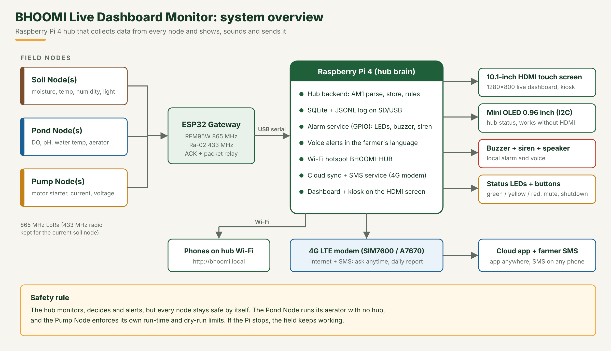

</div>

> ### 🌱 Why BHOOMI
> **Affordable for every farmer, ready for every farm business.** BHOOMI is built from low-cost, widely available parts
> (ESP32, LoRa, capacitive soil sensors, 18650 cells, a Raspberry Pi), so a **small farmer can start with one node** and grow,
> and a **vegetable or aquaculture company can run every plot and pond from one screen**.
> It works **without internet**, speaks the farmer's **own language** (English · తెలుగు · தமிழ்) with **voice**,
> answers on **any basic phone by SMS**, runs **months on one battery**, and every part can be **repaired or replaced locally**.
> 📄 Full case: [Why choose BHOOMI](GENERAL/BHOOMI_Why_Choose_Us.pdf) · [Impact on society](GENERAL/BHOOMI_Social_Impact.pdf)

---

## Tech stack, models and tools

### 🧠 AI and models in UZHAVAN AI
UZHAVAN AI is built to be **explainable**: every decision can be traced to a reading and a rule, and the whole system runs on the farm with no cloud AI.

| Model / engine | What it does | Inputs | Where |
|---|---|---|---|
| **Decision engine (rule-based)** | Irrigation ON/OFF, crop-stress and pond alerts, device-health alerts, every one explained in plain words | Live packets + crop + thresholds | [`server/src/rules.ts`](UZHAVAN%20AI%20SOFTWARES/server/src/rules.ts) · [hub firmware](LIVE_On_Screen_Dashboard/BHOOMI_Hub.ino) |
| **Crop water model** | Start/stop moisture per crop, pond-water suitability (pH, EC, turbidity) | FAO Irrigation & Drainage Paper 29 crop limits | Soil twin stage 3 · hub crop table |
| **Weather-aware irrigation** | Postpones watering when rain ≥ 60 % is forecast in the next 12 h | **Open-Meteo** forecast API | [`server/src/weather.ts`](UZHAVAN%20AI%20SOFTWARES/server/src/weather.ts) |
| **Trend and forecast models** | Linear-regression trends: *hours until the soil is dry* and *oxygen at dawn* | Last 2–6 h of readings | Hub analysis · live dashboard · pond twin cloud layer |
| **Fungal-disease risk model** | Low / medium / high risk from leaf-wet hours, humidity and temperature, before symptoms show | Soil Node AT, AH, LW | Node firmware (FUNGAL flag) + UZHAVAN AI |
| **Dissolved-oxygen model** | Oxygen saturation from water temperature; the oxygen balance from sun, respiration and aerator | Water temperature, DO | Pond firmware + digital twins |
| **Field simulation models** | Soil-water, pond-oxygen and pump models that behave like the real nodes | Weather scenarios | [`sim/`](UZHAVAN%20AI%20SOFTWARES/sim/) · [twins](#6--digital-twins) |
| **Spray breakdown model** | Safe-harvest timer from the label's waiting period, adjusted by soil temperature and moisture (never shorter than the label) | Spray log + Soil Node | UZHAVAN AI app |
| **Soil map** | Interpolates every node's readings into one field map (moisture, temperature, radio coverage) | All Soil Nodes | Soil twin stage 2 |
| **Voice and language** | Spoken and written alerts in English, Telugu and Tamil (Hindi and Kannada on the live screen) | Alert codes | Web Speech API (app) · espeak-ng (Pi) · Unicode SMS |
| **Leaf-disease scan** | Our previous project: tells what is wrong with a leaf. BHOOMI tells what is happening in the soil, air and water around it, and asks for a scan when disease risk is high | Leaf photo | Previous project |

### ⚙️ Hardware and firmware
| Layer | Technology |
|---|---|
| **Microcontrollers** | ESP32-DevKitC 38-pin (soil, pond, hub) · ESP32-S3 (Soil Node PRO) · FireBeetle 2 ESP32-E (buoy option) |
| **Radios** | SX1278 Ra-02 433.5 MHz (soil mesh, hub) · RFM95W 865 MHz (pond) · SX1262 (PRO) · LoRa SF9 / BW 125 kHz / CR 4/5 |
| **Soil sensors** | 2 × capacitive moisture v1.2 · DS18B20 · SHT31 · LM393 LDR · wetness strip · (PRO: RS485 7-in-1, TEROS 12, Watermark, SHT45, BMP390, VEML7700, rain gauge) |
| **Pond sensors** | DFRobot SEN0237-A DO probe · SEN0169-V2 pH · DFR0504 isolators · ADS1115 16-bit ADC · DS18B20 · INA219 current · DS3231 RTC · SSD1306 OLED |
| **Power** | 18650 Li-ion · TP4056/DW01 · CN3791 MPPT · HT7833 / TPS63020 / TPS63802 regulators · 6 V solar panels · Pi UPS HAT |
| **Firmware** | Arduino C++ (ESP32 core 3.0.x) · libraries: LoRa (Sandeep Mistry), OneWire, DallasTemperature, Adafruit ADS1X15 / INA219 / SSD1306 / GFX, RTClib, PubSubClient, Preferences |
| **Protocol** | **AM1** plain-text packets · ACK with settings · mesh relay (up to 4 hops) · duplicate cache · commands with ACK and retries |
| **Design tools** | EasyEDA (schematics, KiCad-importable) · Autodesk Fusion 360 (enclosure, STEP) · Python CSG generator (first enclosure) · PETG/ASA 3D printing |

### 💻 Software
| Layer | Technology |
|---|---|
| **Hub server** | Node.js 22 · TypeScript · Fastify 5 · built-in MQTT broker (aedes) · SQLite (`node:sqlite`) · Server-Sent Events |
| **Farmer app + landing page** | React 18 · Vite 6 · GSAP · Lenis · installable on a phone (PWA) |
| **Digital twins** | Three.js r128 (WebGL) · vanilla JavaScript · Node.js backends with WebSocket, REST, JSONL storage · MQTT / USB serial inputs · Docker + Mosquitto |
| **Farmhouse screen (Pi 4)** | Live dashboard (HTML/JS, Chromium kiosk) · Python services: GPIO alarm (gpiozero), SMS over a 4G modem (pyserial, AT commands, Unicode), OLED (luma.oled) · systemd · NetworkManager hotspot |
| **Testing** | `node:test` unit and end-to-end tests · TypeScript type checks · simulator-driven demos |
| **Fonts and languages** | Noto Sans Telugu / Tamil (SIL OFL) · English, Telugu, Tamil (Hindi and Kannada on the live screen) |

---

## Contents
- [Tech stack, models and tools](#tech-stack-models-and-tools)
- [The problem](#the-problem)
- [How BHOOMI works](#how-bhoomi-works)
- [Repository map](#repository-map)
- [1 · Electronics: the heart of BHOOMI](#1--electronics-the-heart-of-bhoomi)
  - [1.1 Soil Node](#11-soil-node) · [1.2 Pond Node](#12-pond-node) · [1.3 Farm Hub](#13-farm-hub) · [1.4 Radio settings](#14-radio-settings-at-a-glance)
- [2 · Power and battery life](#2--power-and-battery-life)
- [3 · Enclosure (3D CAD)](#3--enclosure-3d-cad)
- [4 · UZHAVAN AI software](#4--uzhavan-ai-software)
- [5 · Live dashboard + SMS](#5--live-dashboard--sms)
- [6 · Digital twins](#6--digital-twins)
- [7 · Smart irrigation concept](#7--smart-irrigation-concept)
- [8 · Impact and value](#8--impact-and-value)
- [Quick start](#quick-start) · [AM1 packet format](#am1-packet-format) · [Status](#status) · [Team](#team)

---

## The problem
- **Irrigation by guesswork.** Small farmers water by habit, wasting groundwater, electricity and diesel, and find dry patches or waterlogging too late.
- **Disease seen too late.** Fungal disease is noticed only when spots appear on the leaves.
- **Fish lost overnight.** Pond oxygen crashes before dawn, so farmers stay awake to switch aerators by hand.
- **Technology out of reach.** Wi-Fi doesn't reach across fields, and commercial sensor systems are costly, need internet and speak only English.

## How BHOOMI works
Small **solar-powered nodes** sit in the field and at the pond and talk over **LoRa**, a long-range, low-power radio. Nodes pass messages for each other (a **mesh**), so the far corners still reach the **hub** at the farmhouse. The hub runs the farm's rules **locally**, so the farm keeps working when the internet is down.

```
 Soil Nodes ──┐                                                    ┌─► Farmer app (EN · తెలుగు · தமிழ், voice)
 Pond Node  ──┼── LoRa mesh ──► Farm Hub (ESP32) ──► UZHAVAN AI ───┼─► Live screen at the farmhouse (Raspberry Pi)
 Pump/valves ─┘   433 / 865 MHz    ACK + settings      rules, alerts └─► SMS to any phone · cloud
        ▲                                                │
        └──────────── commands back: pump, valves, aerator (every command ACKed) ┘
```

| Part | What it does | Folder |
|---|---|---|
| **Soil Node** | Soil moisture at 15 cm and 30 cm, soil temperature, air temperature and humidity, light, leaf wetness. Wakes every 15 min, sends one packet, deep-sleeps on solar + battery | [`BHOOMI_SN/`](BHOOMI_SN/) |
| **Pond Node** | Dissolved oxygen, pH, water temperature. Switches the aerator on by itself when oxygen falls, and alerts on probe, pump or power failure | [`BHOOMI_PN/`](BHOOMI_PN/) |
| **Smart irrigation** | Checks pond water against the crop's limits, treats it if needed, opens zone valves only where the soil is dry | [`GENERAL/`](GENERAL/) |
| **Farm Hub** | ESP32 + LoRa at the farmhouse: ACKs nodes, runs field rules, drives pump/valve relays, talks to the software | [`LIVE_On_Screen_Dashboard/`](LIVE_On_Screen_Dashboard/) |
| **UZHAVAN AI** | The software: hub server, rules, auto-irrigation, alerts, farmer app, simulator | [`UZHAVAN AI SOFTWARES/`](UZHAVAN%20AI%20SOFTWARES/) |

---

## Repository map

| Folder | Contents | Start here |
|---|---|---|
| 📟 [`BHOOMI_SN/`](BHOOMI_SN/) | **Soil Node**: firmware v3.1, P1 + PRO schematics, wiring and power plan, battery-life study, 3D digital twins (single node → 7-node mesh → whole farm), hub bridge firmware | [README](BHOOMI_SN/README.md) |
| 🐟 [`BHOOMI_PN/`](BHOOMI_PN/) | **Pond Node**: 4 firmware sketches (buoy, bank controller, prototype tank, gateway), wiring and parts lists, 4-layer digital twin with the farmer's phone | [README](BHOOMI_PN/README.md) · [ABOUT](BHOOMI_PN/ABOUT.md) |
| 🖥️ [`LIVE_On_Screen_Dashboard/`](LIVE_On_Screen_Dashboard/) | **Farm Hub**: hub firmware v3.0, Raspberry Pi 4 live screen, alarm (LEDs, buzzer, siren, voice), SMS service, pin schematic, BOM | [Readme](LIVE_On_Screen_Dashboard/Readme.md) |
| 🧠 [`UZHAVAN AI SOFTWARES/`](UZHAVAN%20AI%20SOFTWARES/) | **Software**: hub server (rules, MQTT, SQLite, weather), farmer app, landing page, field simulator | [README](UZHAVAN%20AI%20SOFTWARES/README.md) |
| 🧊 [`3D_FUSION_FILES/`](3D_FUSION_FILES/) | **Enclosure**: Fusion 360 STEP files ready to print, drawings, generator scripts, renders and video | [Readme](3D_FUSION_FILES/Readme.md) |
| 📄 [`GENERAL/`](GENERAL/) | **Project documents**: smart irrigation concept, why choose BHOOMI, social impact | [PDFs](#8--impact-and-value) |

---

## 1 · Electronics: the heart of BHOOMI

### 1.1 Soil Node
<table><tr>
<td width="55%">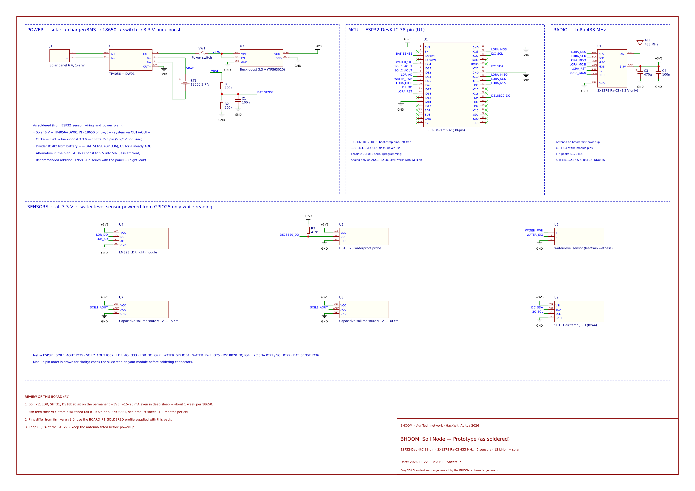</td>
<td>

**Prototype P1: built and soldered**
- ESP32-DevKitC 38-pin + **SX1278 Ra-02 LoRa (433.5 MHz)**
- 2 × capacitive moisture (15 / 30 cm), DS18B20, SHT31, LDR, wetness strip
- 6 V solar → TP4056 → 18650 → 3.3 V regulator
- Sensors switched off between readings (GPIO25 rail)

**Files**
- 🔧 [Firmware v3.1 `BHOOMI_SoilNode.ino`](BHOOMI_SN/ELECTRONICS/BHOOMI_SoilNode.ino)
- 📐 [EasyEDA schematics: P1 + PRO (zip)](BHOOMI_SN/ELECTRONICS/BHOOMI_EasyEDA_Standard_Schematics.zip)
- 📄 [ESP32 sensor wiring and power plan (PDF)](BHOOMI_SN/ELECTRONICS/ESP32%20sensor%20wiring%20and%20power%20plan.pdf)
- 📖 [Soil Node README](BHOOMI_SN/README.md)
</td></tr></table>

**Firmware v3.1, every 15 min:**
1. Wake and switch the sensors on.
2. Read every sensor.
3. Work out the moisture trend and leaf-wet hours.
4. Raise its own flags: **DRY · WET · HEAT · FUNGAL · LOWBAT · SENSOR**.
5. Send one AM1 packet with retries.
6. Read the hub's ACK, which carries **crop dry level, report interval and zone**.
7. Deep-sleep.

It reports **hourly below 3.40 V** and goes **silent for 6 h below 3.30 V**. In relay mode it forwards neighbours' packets, up to **4 hops**.

**Soil Node PRO (next):** ESP32-S3 + SX1262 at 865–867 MHz · MPPT solar charger, 2 × 18650 · RS485 7-in-1 or TEROS 12 soil probe · SHT45, BMP390, VEML7700, rain gauge · 4-layer PCB, IP67, M12 connectors. Schematics are in the zip above.

### 1.2 Pond Node
| Prototype tank (hackathon build) | Floating buoy electronics | Bank-side aerator controller |
|---|---|---|
| 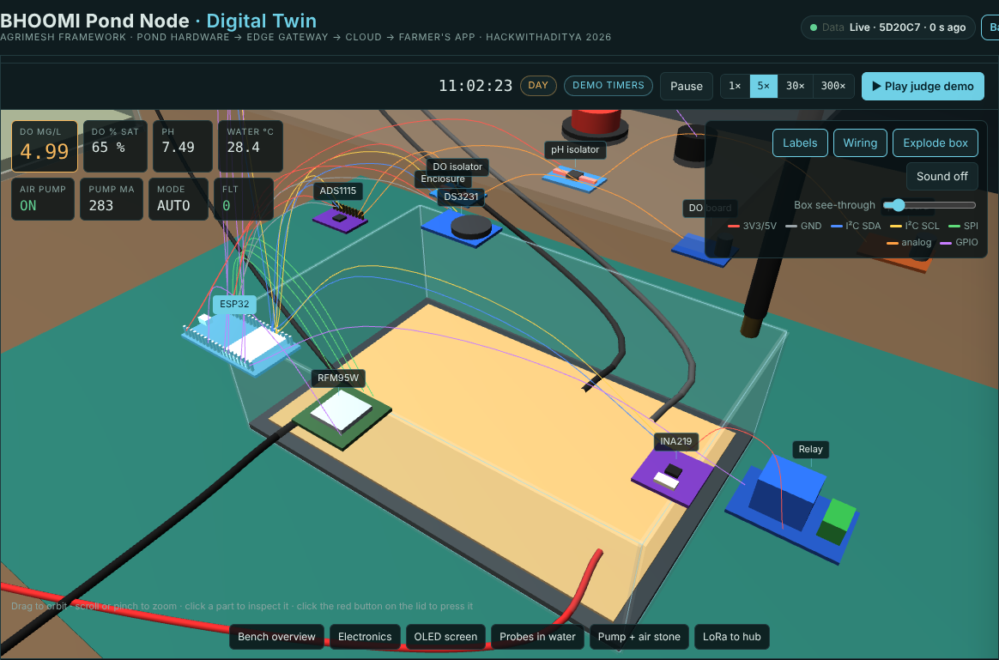 | 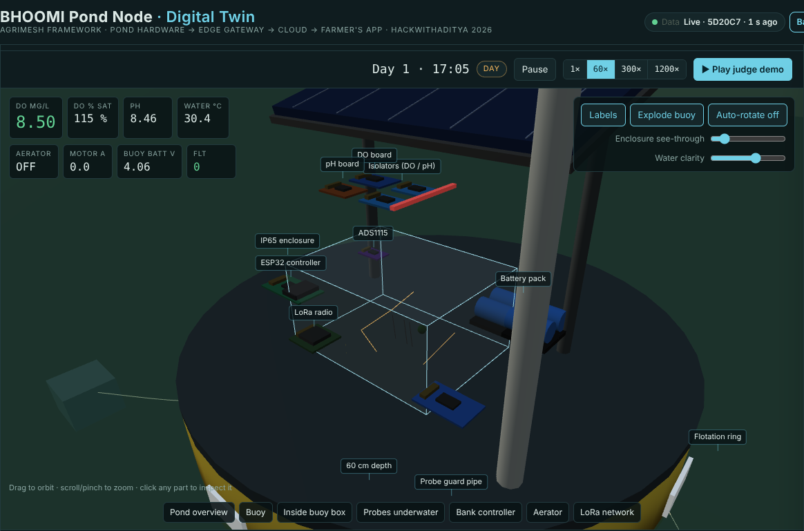 | 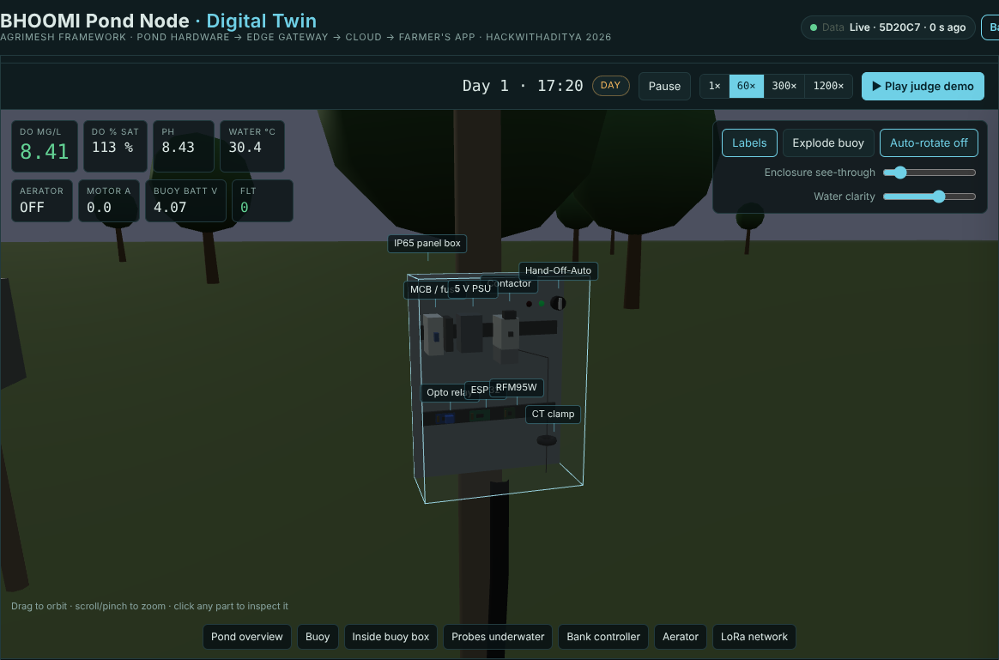 |
| ESP32 · RFM95W · ADS1115 · DO + pH probes with isolators · DS18B20 · INA219 · DS3231 · OLED · relay + 5 V air pump | Solar buoy: ESP32, LoRa, ADS1115, 2 isolators, DO and pH boards, 2 × 18650 + MPPT, IP65 box on a foam ring | DIN box: MCB/fuse, 5 V supply, contactor, opto relay, ESP32 + RFM95W, current clamp, Hand-Off-Auto switch |

| Firmware | Device | Key behaviour |
|---|---|---|
| [`BhoomiPondNode.ino`](BHOOMI_PN/firmware/prototype-tank/BhoomiPondNode/BhoomiPondNode.ino) v2.1 | Prototype tank (one ESP32) | AUTO aerator, also takes hub commands over USB |
| [`PondBuoy.ino`](BHOOMI_PN/firmware/pond-buoy/PondBuoy/PondBuoy.ino) | Floating solar buoy | Deep sleep, 15 / 5 / 30 min intervals, probe faults 1–7, 21 |
| [`PondBank.ino`](BHOOMI_PN/firmware/pond-bank-controller/PondBank/PondBank.ino) | Bank-side controller | **AUTO ON < 4.0 / OFF > 6.0 mg/L**, minimum ON/OFF times, **night failsafe**, faults 10, 11, 20 |
| [`BhoomiPondGateway.ino`](BHOOMI_PN/firmware/gateway/BhoomiPondGateway/BhoomiPondGateway.ino) | Pond edge gateway | LoRa ⇄ backend over MQTT / HTTP / USB, buffers 64 packets offline |

🔌 Wiring, pins and parts with prices: [prototype tank](BHOOMI_PN/firmware/prototype-tank/WIRING.md) · [field pond (buoy + bank)](BHOOMI_PN/firmware/field-pond-WIRING.md) · [firmware guide](BHOOMI_PN/firmware/README.md)

### 1.3 Farm Hub
| Raspberry Pi 4 hub: pin schematic | Wiring of the real parts |
|---|---|
| 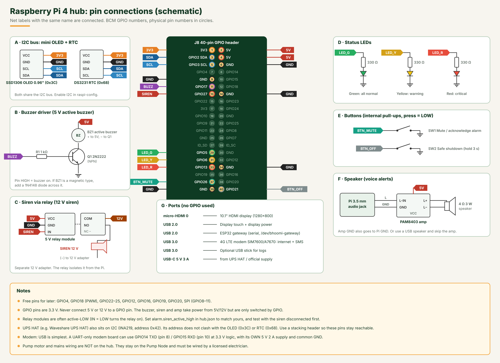 | 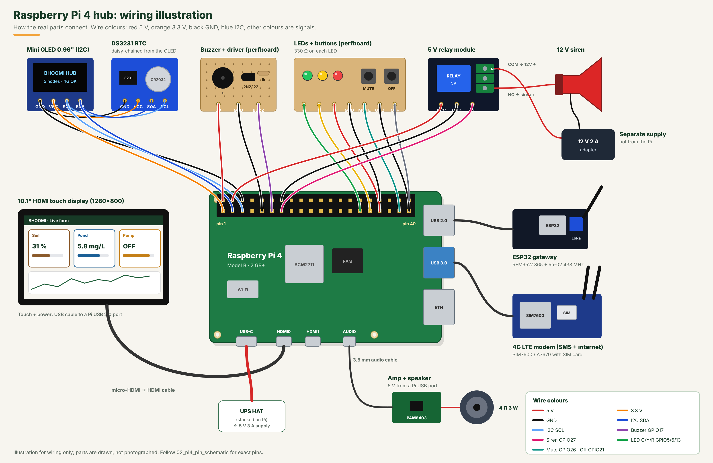 |

- **Hub firmware v3.0, [`BHOOMI_Hub.ino`](LIVE_On_Screen_Dashboard/BHOOMI_Hub.ino)** (ESP32 + SX1278):
  - ACKs every node within about 40 ms and sends their settings back
  - drops duplicate packets and keeps a table of every node
  - runs the UZHAVAN AI field rules (DRY, WET, HEAT, FUNGAL, COLD, BATLOW, SENSOR, SILENT; pond DOCRIT, DOLOW, PHBAD, FAULT)
  - decides irrigation per zone, with a rain skip and a 45-min cap, and drives the pump and valve relays
  - sends aerator commands with retries
  - talks to the software over USB serial or MQTT
- **Hub bridge (mesh) firmware:** [`BhoomiHubBridge.ino`](BHOOMI_SN/MESH_NODE/stage-3-mesh-hub/firmware/BhoomiHubBridge/BhoomiHubBridge.ino)
- **Raspberry Pi 4 parts:**
  - 10.1" HDMI screen and 0.96" OLED
  - DS3231 clock
  - buzzer, 12 V siren on a relay, green/yellow/red LEDs, mute and shutdown buttons
  - speaker for voice alerts
  - 4G LTE modem for SMS
  - UPS HAT for power cuts

  📋 [Pin map](LIVE_On_Screen_Dashboard/DOCS/PIN_MAP.md) · [BOM](LIVE_On_Screen_Dashboard/Hardware/BOM.csv) · [Setup](LIVE_On_Screen_Dashboard/DOCS/SETUP.md)

### 1.4 Radio settings at a glance
| Network | Frequency | Settings | Used by |
|---|---|---|---|
| Soil mesh | **433.5 MHz** | SF9 · BW 125 kHz · CR 4/5 · sync 0x12 · CRC on | Soil Node v3.1, Farm Hub v3.0, Hub Bridge |
| Pond network | **865.0625 MHz** | SF9 · BW 125 kHz · CR 4/5 · sync 0x12 · CRC on | PondBuoy, PondBank, BhoomiPondNode, Pond Gateway |

> One hub radio can't hear both bands. Use two radios at the hub, or move the soil network to 865–867 MHz with the PRO node.

---

## 2 · Power and battery life
| | P1 as soldered | P1 + switched sensor rail | PRO |
|---|---|---|---|
| Sleep current | ≈ 15 mA | ≈ 1 mA | ≈ 35 µA |
| Energy per day | 370 mAh | 33 mAh | 12.6 mAh |
| **Life with no sun** | ≈ 6 days | **≈ 73 days** | **≈ 381 days** |

| Power chain P1 vs PRO | Battery life and solar |
|---|---|
| 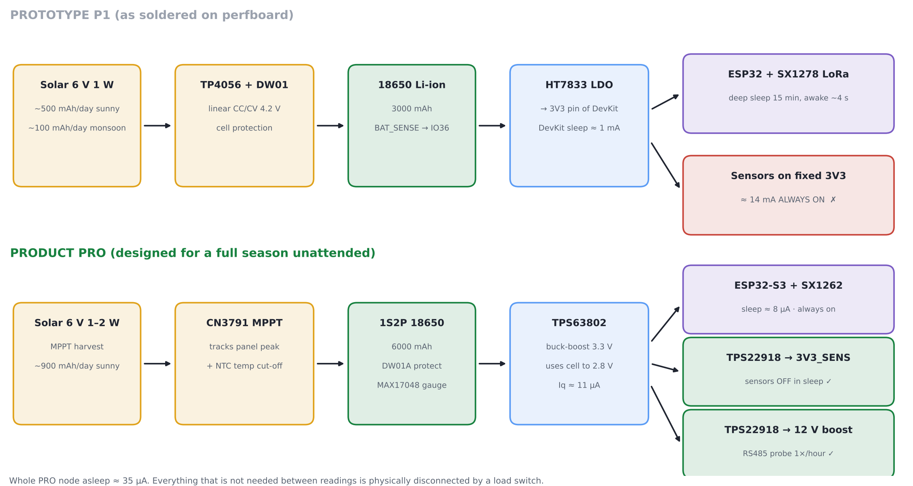 | 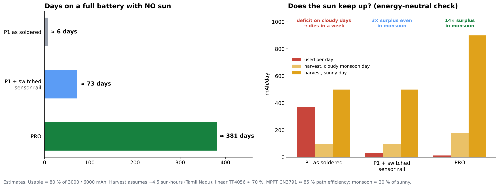 |

📄 [Full power study (PDF)](BHOOMI_SN/BHOOMI_SoilNode_Power/BHOOMI_SoilNode_Power_Life.pdf) · [Power README](BHOOMI_SN/BHOOMI_SoilNode_Power/README.md) · [Daily energy budget](BHOOMI_SN/BHOOMI_SoilNode_Power/02_daily_energy_budget.png) · [Adaptive duty cycle](BHOOMI_SN/BHOOMI_SoilNode_Power/04_adaptive_duty_cycle.png)

---

## 3 · Enclosure (3D CAD)
| Assembled node | Top node | Spiked bottom | Top cap |
|---|---|---|---|
| 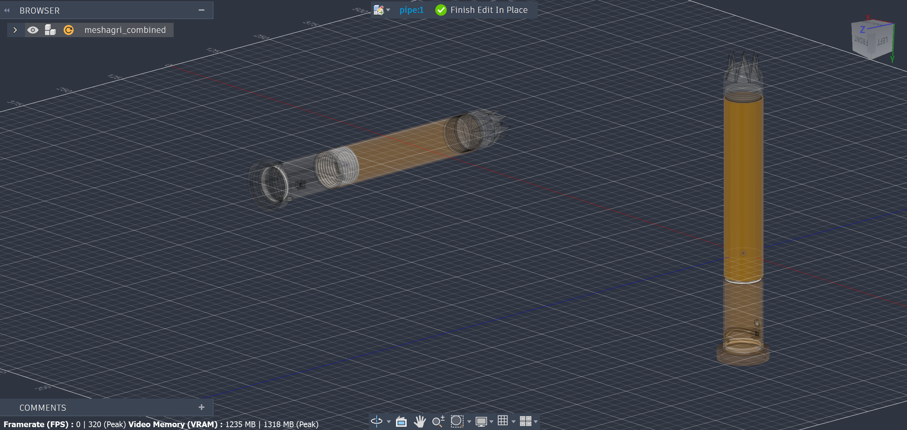 | 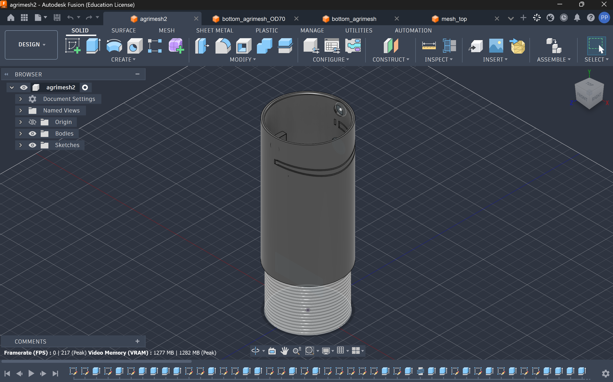 | 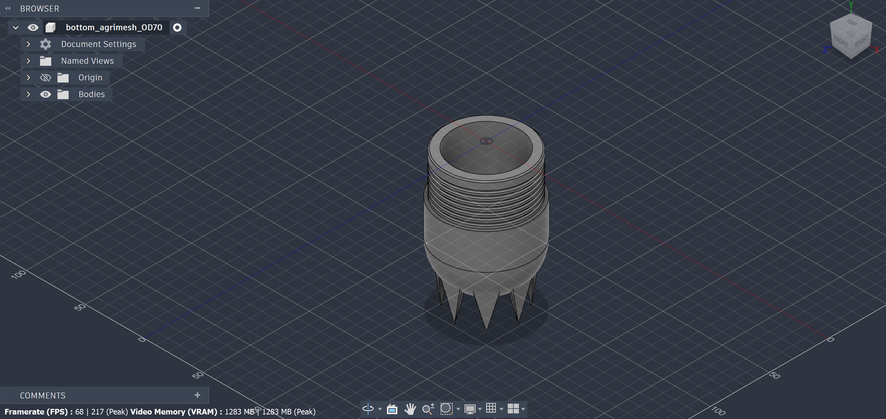 | 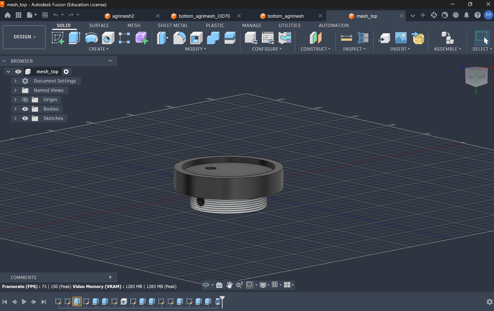 |

- **Ready to print** (Fusion 360 → STEP): [`TOP_NODE.step`](3D_FUSION_FILES/FINAL_PRINT/TOP_NODE.step), [`bottom_agrimesh_OD70.step`](3D_FUSION_FILES/FINAL_PRINT/bottom_agrimesh_OD70.step), [`TOP_CAP.step`](3D_FUSION_FILES/FINAL_PRINT/TOP_CAP.step)
- **First design:**
  - drawing sheets [1](3D_FUSION_FILES/AgriMesh_soil_node_sheet1.png), [2](3D_FUSION_FILES/AgriMesh_soil_node_sheet2.png) and [3](3D_FUSION_FILES/AgriMesh_soil_node_sheet3.png), covering assembly, head, lid, sled, shield and parts list
  - [`GENERATED.zip`](3D_FUSION_FILES/GENERATED.zip) with the STEP/STL files and the Python generator
- **Print in PETG or ASA**, not PLA, because PLA softens in the sun. 🎬 [Modelling video](3D_FUSION_FILES/MEDIA_FILES_%28IMG%26VED%29/top_build.mp4) · 📖 [Enclosure README](3D_FUSION_FILES/Readme.md)

---

## 4 · UZHAVAN AI software
**UZHAVAN AI** (*uzhavan* means "farmer" in Tamil) is the brain of BHOOMI. It turns packets into decisions:

| Area | What it decides | Driven by |
|---|---|---|
| **Irrigation** | Pump ON when the topsoil is dry and no rain is forecast. Pump OFF when the 30 cm layer is full, rain starts or the field is waterlogged. Postpone if rain is ≥ 60 % likely | Soil Node + Open-Meteo forecast → pump switch |
| **Crop health** | Heat and cold stress, fungal-disease risk, waterlogging | Soil Node air and leaf readings |
| **Pond** | DO < 4 mg/L warning, < 3 critical + SMS, pH range, aerator and probe faults | Pond Node |
| **Devices** | Silent nodes, unplugged sensors (`NA`), low battery, lost or duplicate packets, unconfirmed commands | Every node |
| **Spray log** | Safe-harvest timer, never shorter than the pesticide label | Soil temperature and moisture |

Built with Fastify, MQTT (aedes), SQLite, React + Vite, and a field simulator that behaves exactly like the firmware. Alerts are in English, Telugu and Tamil with voice, and SMS goes out in the farmer's language.
📖 [UZHAVAN AI README](UZHAVAN%20AI%20SOFTWARES/README.md) · 🔌 [Gateway ↔ server contract](UZHAVAN%20AI%20SOFTWARES/docs/GATEWAY_API.md) · 🎬 [Demo walkthrough](UZHAVAN%20AI%20SOFTWARES/docs/DEMO.md)

---

## 5 · Live dashboard + SMS
| Live farm screen at the farmhouse | SMS: ask any time + daily report |
|---|---|
| 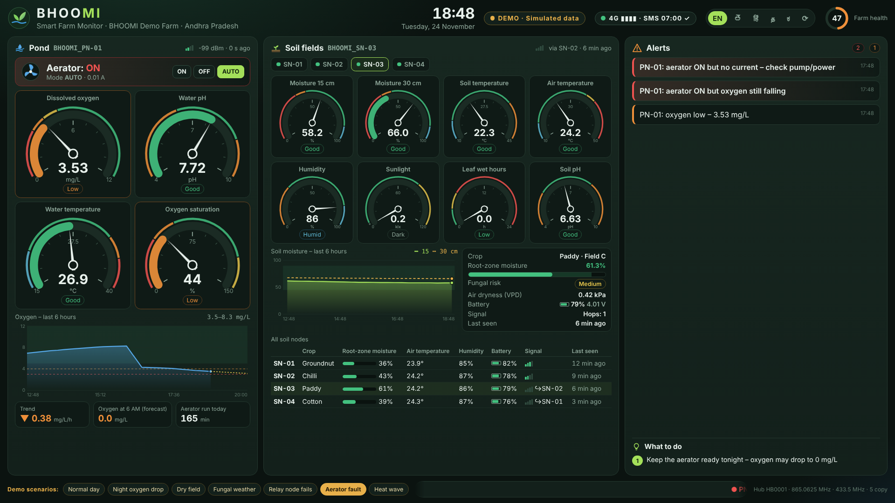 | 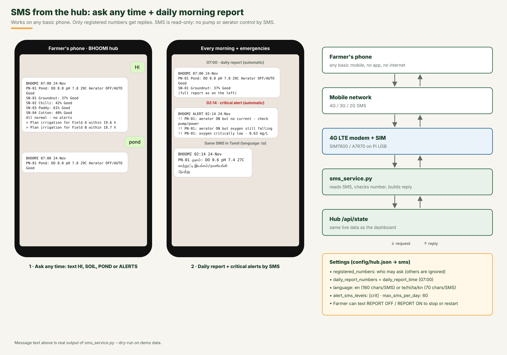 |

- **Live screen:** a Raspberry Pi 4 with a 10.1" HDMI screen in kiosk mode. Pond gauges, soil fields, alerts on the full right side, in 5 languages. Phones on the hub Wi-Fi can open it too.
- **SMS:** a farmer texts **HI** to the hub and gets the live report. Every morning at **07:00** the report arrives by itself, and critical alerts are sent at once. Only registered numbers get replies, and SMS can't switch the pump or aerator.
- **Alarm:**
  - green, yellow and red lights
  - a 12 V siren for critical alerts
  - spoken alerts in the farmer's language
  - a mute button
- 📖 [Dashboard Readme](LIVE_On_Screen_Dashboard/Readme.md) · [What the screen shows](LIVE_On_Screen_Dashboard/DOCS/DISPLAY_CONTENT.md) · [Alarm logic](LIVE_On_Screen_Dashboard/DOCS/ALARM_LOGIC.md) · [SMS guide](LIVE_On_Screen_Dashboard/DOCS/SMS_GUIDE.md) · [Data contract](LIVE_On_Screen_Dashboard/DOCS/DATA_CONTRACT.md) · [Dashboard page](LIVE_On_Screen_Dashboard/Software/index.html)

---

## 6 · Digital twins
Interactive **3D copies of the hardware** (Three.js) running the same rules as the firmware. Each one runs its own simulation, or switches to **live data** from the backend or from real nodes.

**Soil:** one node → a 7-node field with a self-healing mesh → the whole farm on one mesh
| Stage 1 · Single node | Stage 2 · 7-node mesh field | Stage 3 · Whole farm + hub |
|---|---|---|
| 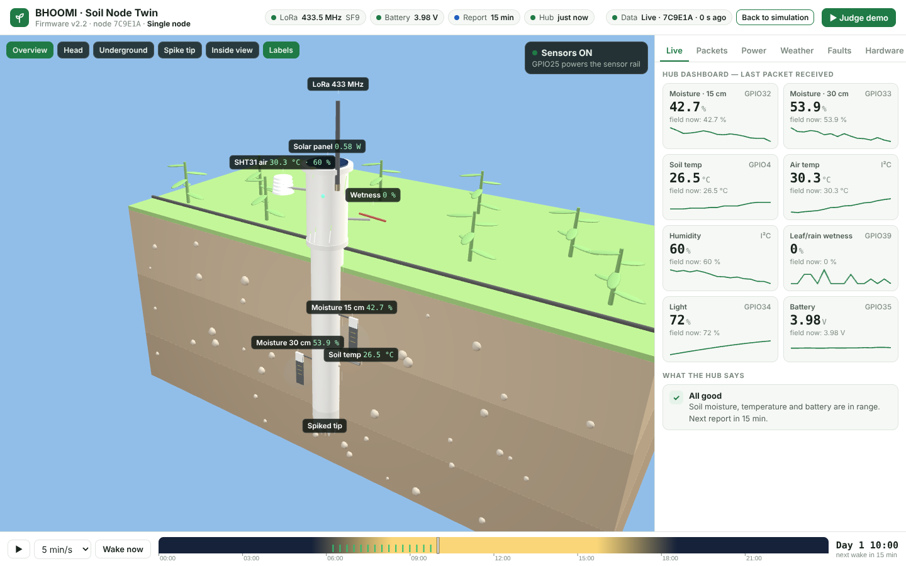 | 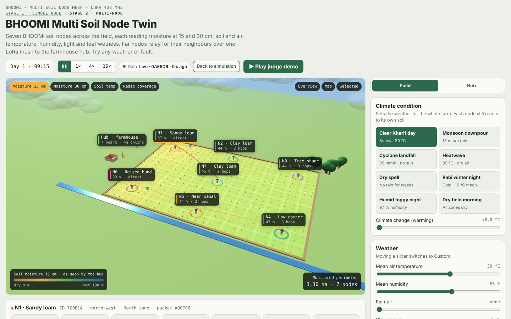 | 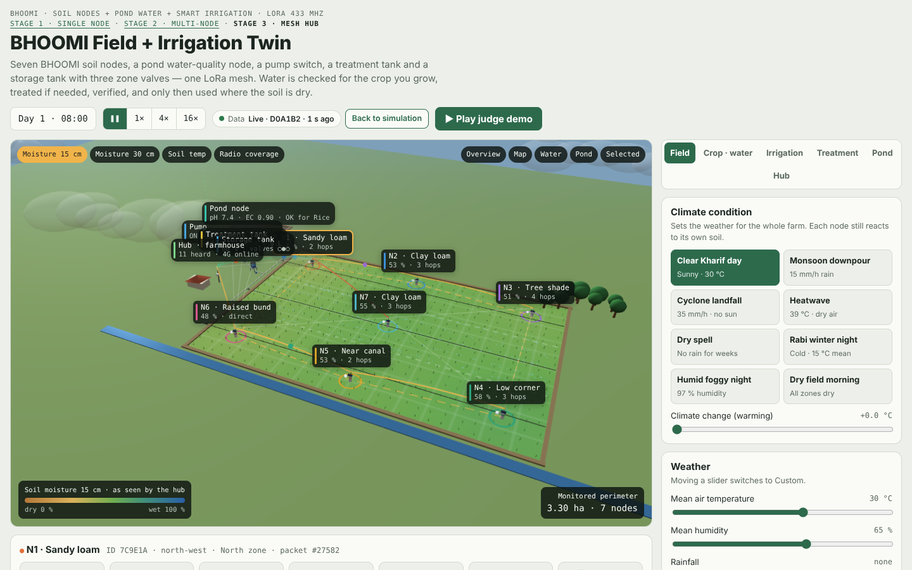 |
| [Single node twin](BHOOMI_SN/INDIVIDUAL_SOIL_NODE/) | [Multi-node twin](BHOOMI_SN/MULTIPLE_SOIL_NODE/) | [Mesh hub twin (complete set)](BHOOMI_SN/MESH_NODE/) |

**Pond:** the 4-layer framework of field hardware, edge gateway, cloud and farmer's phone
| The whole twin | Night oxygen crash: aerator starts itself | Alerts in Telugu with voice |
|---|---|---|
| 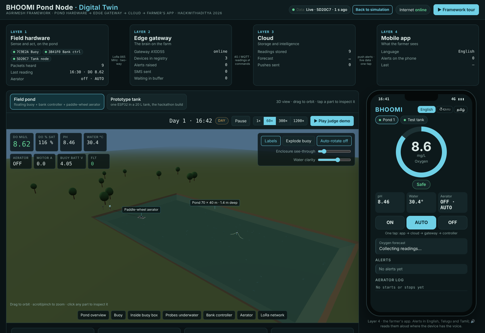 | 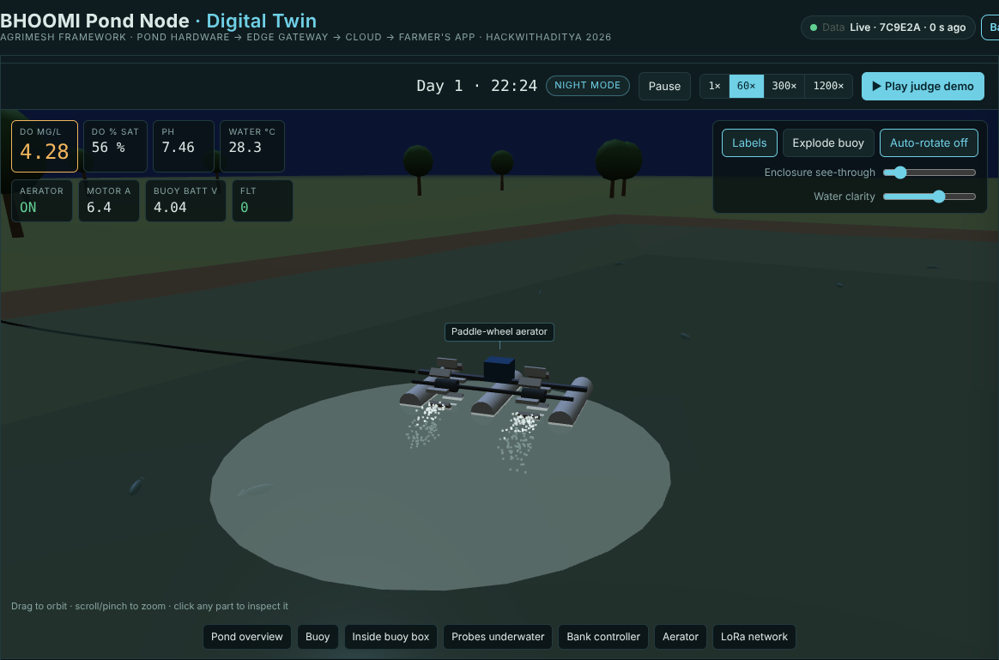 | 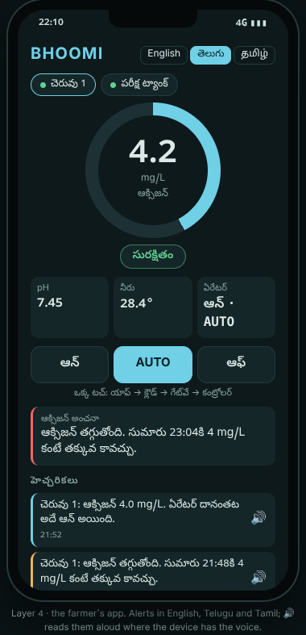 |

📖 [Pond twin README](BHOOMI_PN/README.md) · [Full write-up](BHOOMI_PN/ABOUT.md) · [Every screenshot explained](BHOOMI_PN/media/README.md) · [Architecture](BHOOMI_PN/docs/architecture.md)

---

## 7 · Smart irrigation concept
📄 [**Smart irrigation concept (PDF, 10 pages)**](GENERAL/Smart%20irrigation%20Concept.pdf): how BHOOMI decides **when, where and how much** to water.

**The cycle:** Measure → Validate → Analyse → Decide → Irrigate → Verify → Record

It also covers:
- the hardware building blocks (pump, valves, flow and pressure feedback)
- control modes
- water-quality and agronomy limits
- safety and failure handling
- a staged roll-out, from a bench test to fully automatic control

---

## 8 · Impact and value
| Document | What it shows |
|---|---|
| 📄 [**Why choose BHOOMI**](GENERAL/BHOOMI_Why_Choose_Us.pdf) | Affordable to start, pays back on the farm, comfortable for every farmer, easy to maintain, scales for farm businesses |
| 📄 [**Impact on society**](GENERAL/BHOOMI_Social_Impact.pdf) | Sensor-to-society flowchart, 8 sectors that benefit, impact by area, farmer payback loop, business model, roll-out plan |

**Who benefits:**
- small and marginal farmers
- aquaculture farmers
- farmer producer organisations (FPOs) and cooperatives
- agri and vegetable companies
- consumers (safe-harvest timer)
- the environment (less groundwater pumped, fewer sprays)
- rural youth (installation and repair jobs)
- government officers (district-level data)

---

## Quick start
| Run | Commands |
|---|---|
| **UZHAVAN AI** (hub server + farmer app + simulator) | `cd "UZHAVAN AI SOFTWARES" && npm install && npm run demo` → http://localhost:8080 · app at `/app/` (Node.js 22.18+) |
| **Soil twins** | `cd BHOOMI_SN/MESH_NODE/backend && npm start` → http://localhost:8080 → pick a stage → **Go live** (Node.js 18+) |
| **Pond twin** | `cd BHOOMI_PN/backend && npm start` → **Go live** → **Framework tour**, or open `BHOOMI_PN/frontend/index.html` straight from disk |
| **Live dashboard demo** | Open [`LIVE_On_Screen_Dashboard/Software/index.html`](LIVE_On_Screen_Dashboard/Software/index.html) in a browser (add `#night`, `#dry`, `#aer` for scenarios) |
| **Flash firmware** | Arduino IDE 2 / `arduino-cli`, board **ESP32 Dev Module**. Libraries: LoRa (Sandeep Mistry), OneWire, DallasTemperature, Adafruit ADS1X15 / INA219 / SSD1306, RTClib, PubSubClient |

## AM1 packet format
Every node speaks one simple text format, so the hub, twins and software all read the same packets:
```
AM1,ID=7C9E1A,T=SOIL,N=1043,Z=1,M1=42.5,M2=58.1,ST=26.8,AT=31.2,AH=78.4,LW=12,LX=54.3,BV=4.02,DM1=-1.8,LWH=0.0,FLG=0,HOP=0
AM1,ID=7C9E2A,T=POND,N=212,DO=5.84,DOS=76,PH=7.31,WT=28.6,AER=0,AERI=0.00,BV=5.02,FLT=0
AM1,ID=HUB001,T=CMD,N=17,DST=7C9E2A,AER=ON,TS=1795190000      →   AM1,ID=7C9E2A,T=ACK,N=17,OK=1,MODE=ON,AER=1
```
Full specs: [soil packet format](BHOOMI_SN/MESH_NODE/docs/packet-format.md) · [pond packet format](BHOOMI_PN/docs/packet-format.md) · [gateway contract](UZHAVAN%20AI%20SOFTWARES/docs/GATEWAY_API.md)

---

## Status
| Part | Status |
|---|---|
| Soil Node P1 hardware | ✅ Soldered and reviewed |
| Soil Node firmware v3.1 · Farm Hub firmware v3.0 · Hub bridge | ✅ Compile for ESP32 Dev Module · ⏳ hardware test in progress |
| Pond Node firmware (4 sketches) | ✅ Compile (core 3.0.7) · ⏳ not yet tested together on hardware |
| UZHAVAN AI software | ✅ Runs end to end with the simulator · ⏳ not yet run against real nodes |
| Digital twins (soil stages 1–3, pond) | ✅ Running with live backends |
| Live dashboard, alarm, SMS services | ✅ Tested on demo data · ⏳ Pi wiring and 4G modem to test |
| Enclosure | 📝 Designed in Fusion 360 |
| Soil Node PRO | 📝 Concept and schematics |

**Notes:**
- The twins and the simulator use illustrative models; real numbers will come from bench and field trials.
- Crop water limits follow FAO Irrigation & Drainage Paper 29.
- Mains wiring on the pond and pump side must be done by a licensed electrician.

## Use of AI tools
As the hackathon rules require, we disclose that the team used AI coding assistants while writing parts of the software and documentation. Every part was reviewed by the team, and we can explain and modify all of it.

## Team
| Member | Role |
|---|---|
| **Nithin R** | Team lead · system design · Soil Node |
| **Purushothaman B** | Soil Node hardware, sensors and power |
| **Ashwin R** | Software, backend and UZHAVAN AI |
| **Harikarthik R B** | Software, backend and UZHAVAN AI |
| **Nishanth P R** | Power management · Pond Node documentation and testing |

<div align="center">

**Team BHOOMI · Chennai Institute of Technology · HackWithAditya 2026**
Digital twins: MIT licence ([soil](BHOOMI_SN/MESH_NODE/LICENSE) · [pond](BHOOMI_PN/LICENSE)) · Three.js © Three.js authors (MIT) · Noto Sans fonts (SIL OFL 1.1)

</div>
